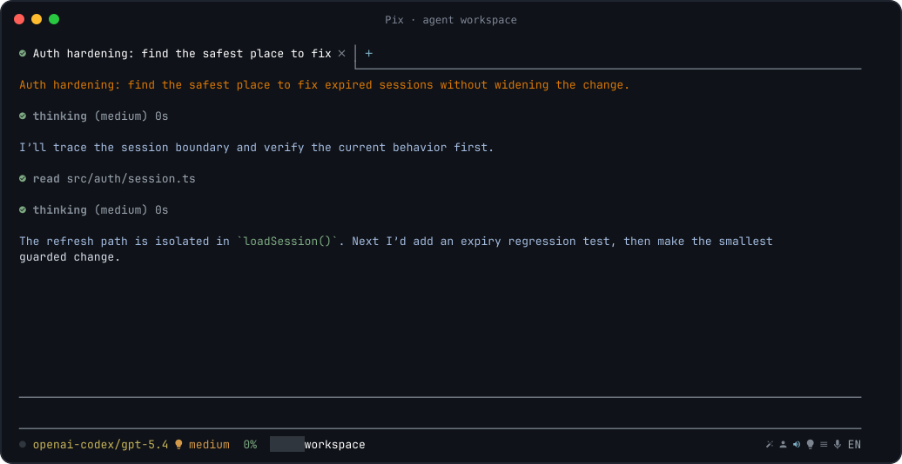
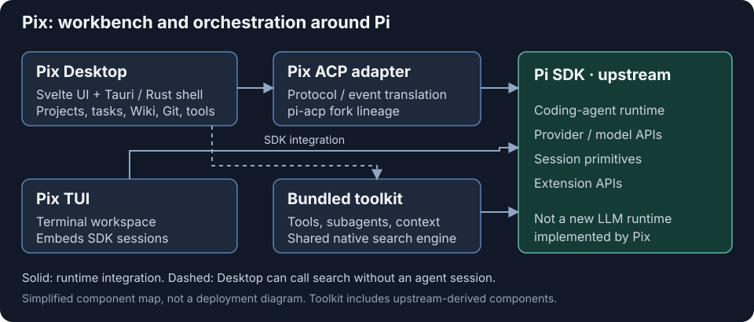

# Pix — AI-Native Development Workbench

[](https://github.com/dnaroid/pix/actions/workflows/check.yml)
[](https://github.com/dnaroid/pix/releases/latest)

**A developer workspace built around coding agents, project knowledge, task
execution and code review — on top of [Pi SDK](https://github.com/earendil-works/pi).**

I built Pix for my daily commercial development: to keep repository context,
long-running agent work, tools, changes and verification in one workflow rather
than scattered across chats and terminals. **Pix Desktop is the primary frontend**;
a cross-platform TUI is also available.

[Download](https://github.com/dnaroid/pix/releases/latest) ·
[Quick start](#quick-start) · [Engineering highlights](#engineering-highlights) ·
[Wiki](wiki/index.md)

## From a task to reviewed changes

- **Project workbench:** conversations, files, Wiki, durable tasks and plans,
  Git diffs and terminals in one workspace.
- **Agent orchestration:** linked task sessions, asynchronous subagents,
  inspectable tool activity, cancellation and follow-up delivery.
- **Repository context:** search enabled code, knowledge, sessions, tasks and
  commits; lexical retrieval is local, semantic retrieval is optional.
- **Continuity:** reopen and fork Pi sessions, restore workspace tabs, and
  recover raw session evidence after context compaction.
- **Execution and review:** file/shell tools, AST search and rewrites, diagnostics,
  test commands and Source Control for reviewing the resulting diff.

**Example workflow:** open a project → define a task and acceptance criteria →
retrieve relevant context and read the source → let the agent edit and run
focused checks → inspect tool output and the Git diff → decide what to commit.
Independent investigation can use subagents; a completion message is not a
substitute for tests or human review.

### Preview



*Real TUI renderer, deterministic `MockModel` fixtures—not a Desktop screenshot
or a live-agent run. [Capture provenance and Desktop recording scenario](wiki/development/testing/task-to-diff-demo.md).
A native Desktop walkthrough has not yet been added.*

## Engineering Highlights

Four implementation decisions worth inspecting. The linked tests cover specific
invariants; they are not a claim of general agent correctness or current CI status.

| Problem | Design decision and implementation | Verification |
| --- | --- | --- |
| Late activity can reach a closed or reopened session; replay can monopolize rendering. | [Attachment ownership](desktop/src/app/session-activity.svelte.ts) rejects stale activity, even after same-ID reopen. The [replay queue](desktop/src/app/session-update-batcher.ts) processes at most 128 updates per animation frame and filters canceled answer/thought chunks. | [Ownership regressions](desktop/src/app/session-activity.test.ts), [ordered replay/cancellation tests](desktop/src/app/session-update-batcher.test.ts); [lifecycle contract](wiki/architecture/desktop-async-lifecycle.md). |
| A child may finish while its parent is waiting, canceling or switching sessions. | [Completion delivery](external/pi-tools-suite/src/async-subagents/completion-delivery.ts) reserves results for active waiters and acknowledges only returned terminal states; aborted waits release notifications and parent-session identity limits consumption. | [Wait/abort/stale-launch and cross-session regressions](external/pi-tools-suite/test/async-subagents/completion-delivery.test.ts); [subagent contract](wiki/tools/agents/async-subagents.md). |
| Compaction removes useful details from the model's current context. | [Session recovery](external/pi-tools-suite/src/session-recovery/index.ts) reads Pi-owned raw history with branch scope, bounded output and continuation cursors, rather than inventing a second source of truth. | [Pre-compaction, Unicode, branch and cursor tests](external/pi-tools-suite/test/session-recovery.test.ts); [recovery contract](wiki/context/session-recovery.md). |
| Context retrieval must not silently require a cloud index or accept canceled results. | [Native search](wiki/search/native-repository-search.md) separates local lexical retrieval from explicitly configured semantic uploads. The [Desktop transport](desktop/src/lib/native-repository-search.ts) owns requests independently of ACP sessions and rejects late responses after cancellation. | [Transport cancellation and listener-cleanup tests](desktop/src/lib/native-repository-search.test.ts); [search architecture decisions](wiki/search/index.md). |

## Architecture and ownership



- **Pix:** workspace/frontends, integration policies, orchestration, context tools,
  lifecycle handling and verification/release infrastructure. I own architecture,
  decomposition, agent coordination, review and final decisions; **AI agents
  perform a substantial part of implementation**.
- **Pi SDK:** the underlying coding-agent runtime, provider/model APIs, session
  primitives, extension ecosystem and terminal primitives—not a runtime built
  from scratch by Pix.
- **ACP adapter:** Pix integration with [upstream pi-acp lineage](https://github.com/svkozak/pi-acp).
  Bundled tools and dependencies also include upstream-derived components.

See [component boundaries](wiki/architecture/index.md), the
[ACP adapter](wiki/architecture/acp.md) and [bundled toolkit](wiki/tools/suite.md).
Tool policies are not an OS security sandbox. Optional integrations need their
own configuration; semantic search can upload selected text to a configured
provider. [Observer](wiki/assistants/index.md) is experimental and opt-in.

**Stack:** TypeScript / Node.js · Svelte 5 · Tauri 2 / Rust · Pi SDK · ACP ·
SQLite · ast-grep. Verification uses Node's test runner, Bun, Vitest, Rust tests
and Playwright, with different scopes described below.

## Quick start

### Desktop — macOS 13.5+ on Apple Silicon

1. Download the `.dmg` from [GitHub Releases](https://github.com/dnaroid/pix/releases/latest)
   and verify it against the release's `SHA256SUMS`.
2. Copy Pix Desktop to Applications or `~/Applications` and launch it.
3. Connect your model providers, select **Main / Fast / Strong** models in the
   setup wizard, and open a project.

Desktop bundles Node.js and the Pix/ACP runtime: **no separate Node.js, npm or
TUI installation is required**. Packaged production builds support signed
native updates. Windows and Linux Desktop builds are not currently supported.

### TUI — Windows x64, Linux x64, macOS Apple Silicon

Download the matching `pix-tui` archive from the same release and verify
`SHA256SUMS`. Extract the **whole archive**, keep its bundled files together,
then run its launcher (or add that directory to `PATH`):

```sh
pix --cwd /path/to/project
```

On Windows, use `pix.cmd`. Desktop and TUI use Pi sessions but have independent
configuration and open-tab state. Distribution is through GitHub Releases, not npm.

See [installation, checksums and upgrades](wiki/getting-started/installation.md),
the [Desktop guide](wiki/desktop/guide.md) and [TUI guide](wiki/tui/guide.md).
For source development, Node.js `>=22.19.0 <27` and the relevant native toolchain
are required; follow the [development guide](wiki/development/guide.md).

## Testing, CI and releases

- **Local development:** run focused tests and relevant typechecks/builds for
  the changed boundary. Documentation changes use `npm run check:wiki`.
  The full local `npm run check:ci` is reserved for release preparation or an
  explicit push-everything request; see [verification policy](wiki/development/guide.md#verification-before-pushing).
- **CI:** [Check](.github/workflows/check.yml) runs root/ACP/tools-suite checks
  on Linux, macOS and Windows. Desktop frontend/Rust checks are macOS-only;
  the Ubuntu Playwright job tests a mocked browser workspace, not native Desktop.
  Consult [live Actions results](https://github.com/dnaroid/pix/actions/workflows/check.yml)
  for current status—a local pass does not establish matrix health.
- **Releases:** [Publish](.github/workflows/publish.yml) builds native TUI packages
  for all three targets and Desktop for macOS, runs package smoke checks, and
  gates public checksums/updater metadata on the required matrix.
  Updater signing is distinct from Apple code signing/notarization.

Details: [testing and QA](wiki/development/testing/index.md) ·
[executable CI/release contract](wiki/development/release/ci-release.md).

## Documentation

- [Wiki index](wiki/index.md) · [Full capability overview](wiki/overview.md)
- [Architecture](wiki/architecture/index.md) · [Development](wiki/development/index.md)
- [Configuration](wiki/configuration/index.md) · [Agent tools](wiki/tools/index.md)
- [Search](wiki/search/index.md) · [Context management](wiki/context/index.md)
- [Work management](wiki/work-management/index.md) · [Design decisions](wiki/decisions/index.md)

Detailed behavior, platform limits and experimental contracts live in the Wiki;
this page is the short path through the system.
