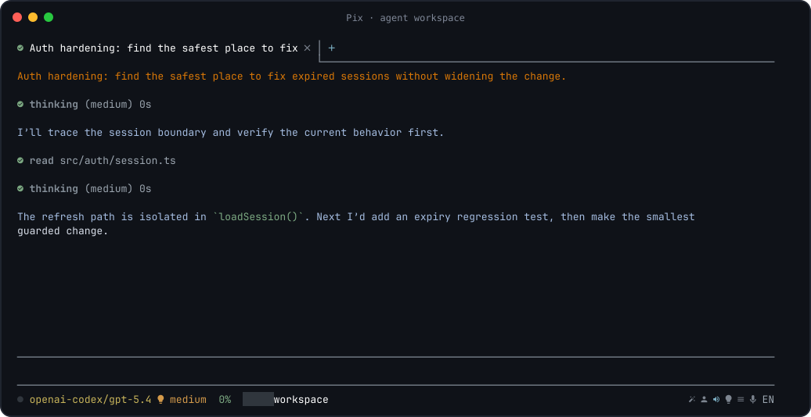
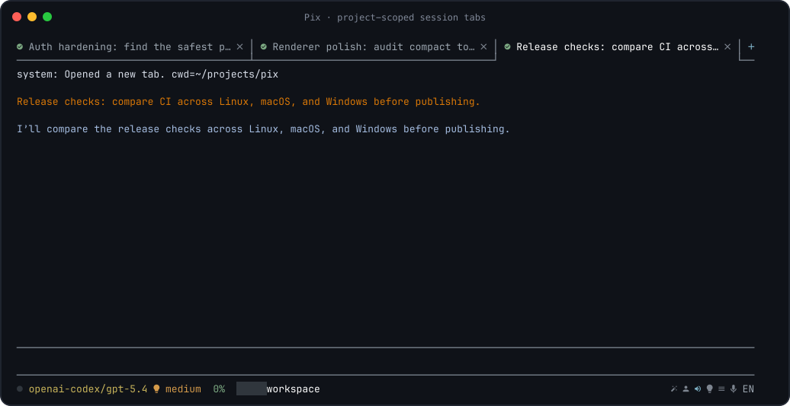

<!-- pix:wiki-report {"version":1,"checkedAt":"2026-10-30T23:03:49.767Z","result":{"path":"wiki/index.md","documentHash":"e24f8df5d21caa73aa5b1c3afbefc9a9f9e0e32e45a6d5e49b14fbdbcd55336e","modelRef":"zai/glm-5.3-flash","reportLanguage":"ru","checkedSources":12,"conflicts":[],"uncertainties":[],"reviewedSources":[{"path":"wiki/overview.md","quote":"\n# Pix\n\n**A workspace-first coding UI for [Pi](https://github.com/badlogic/pi-mono) —\navailable as a terminal TUI and a native Desktop app.**\n\nPersistent workspaces, readable agent activity, project tools, Source Control,\nrepository intelligence, voice input and a bundled toolkit for serious coding\nsessions.\n\n[](https://github.com/dnaroid/pix/actions/workflows/check.yml)\n\n\u003c!-- markdownlint-disable MD013 --\u003e\n\n\n\n## Start\n\nDownload the latest **TUI** archive for your OS/CPU, or the **Pix Desktop**\ninstaller for macOS Apple Silicon, from\n[GitHub Releases](https://github.com/dnaroid/pix/releases).\n\nStable release packages contain their own Node.js runtime and Pix dependencies;\nNode/npm is not an end-user prerequisite.\n\n### Give the installation to an LLM\n\nPaste this into a coding agent with terminal/web access:\n\n```text\nInstall and configure the latest stable Pix from https://github.com/dnaroid/pix\nfor this machine. Follow\nhttps://github.com/dnaroid/pix/blob/master/wiki/getting-started/llm-install.md exactly.\nDetect OS/CPU, preserve Pi/Pix config and sessions, remove only confirmed legacy\nPix installs/wrappers, install the matching GitHub Release assets, verify them\nagainst SHA256SUMS, configure without overwriting credentials, and verify the\nTUI plus Pix Desktop on macOS Apple Silicon when the Desktop asset is present.\n```\n\nFull agent contract: **[LLM installation](getting-started/llm-install.md)**.\n\nManual install/update/legacy cleanup:\n**[Installing Pix](getting-started/installation.md)**.\n\n## TUI or Desktop?\n\n| | Pix TUI | Pix Desktop |\n| --- | --- | --- |\n| Interface | terminal-native workspace | native Tauri/Svelte workbench |\n| Sessions | persistent project-scoped tabs | persistent conversation/workbench tabs |\n| Project files | file links and agent tools | dedicated Project Explorer + Preview |\n| Project Wiki | Markdown files and agent tools | Wiki sidebar, sections and visual Markdown editor |\n| Git | `/code-review`, `/commit-message` | full Source Control panel |\n| Tasks | durable suite todos | project task manager + session links |\n| Registry | — | dedicated Registry panel (Desktop only) |\n| Repository search | native Code/Knowledge via `project_search` | native Code/Knowledge via `project_search` |\n| Shell | inline `!` and raw `!!` terminal | package scripts + interactive terminals |\n| Configuration | `pix.jsonc` | independent `pix-desktop.jsonc` |\n\nYou can install either frontend or both. Pix Desktop bundles its own Pix/ACP\nruntime and does not require the TUI.\n\n## Why Pix?\n\n- **See the work, not the noise.** Thinking, reads, searches, edits, failures,\n  todos and sub-agents get purpose-built presentation instead of raw log spam.\n- **Keep projects organized.** Sessions, tasks, files, Git state and project\n  resources stay attached to the workspace you are actually editing.\n- **Stay in flow.** Search commands, run local shells, open files, paste images,\n  dictate prompts and use model-backed helper workflows without leaving Pix.\n- **Use the models you want.** Pix keeps Pi's provider ecosystem, model\n  switching, thinking levels and persistent session format.\n- **Bring repository-scale tools.** The bundled `pi-tools-suite` adds indexed\n  discovery, AST tools, LSP diagnostics, parallel agents, durable planning,\n  context compression, registry workflows and more.\n\nPix is not a separate agent protocol replacing Pi. It runs on the Pi SDK, so Pi\nmodels, tools, skills, extensions and sessions remain part of the same\necosystem.\n\n## Pix Desktop\n\nPix Desktop turns the same Pi/Pix runtime into an IDE-like native workbench.\n\nAssistant messages can include `pix-html` blocks that automatically\npreview self-contained HTML/JavaScript prototypes or Canvas games in a\nsandboxed iframe. Native form Submit and `window.pix.submit(json)` return\ndata to the current ACP conversation without overwriting your draft.\nThe iframe auto-fits the game's content up to a bounded height, uses the\nnative Pix scrollbar styling, and gives the agent the available inline width\nwhen you request an interactive prototype.\nSee [HTML Sandbox](desktop/rendering/desktop-html-sandbox.md) for the syntax and limits.\n\n**Platform support:** Pix Desktop currently supports **macOS on Apple Silicon\nonly**. Windows and Linux Desktop packages are not currently published or\nplatform-validated in CI. The Pix TUI remains supported on the release targets\nlisted below.\n\nThe Activity Bar provides:\n\n- **Tasks** — full interactive Desktop manager over project-local\n  `.pi/tasks.sqlite` (Quick Add, edit, priority/status, drag-and-drop,\n  attachments and linked sessions); `/task` slash commands and restricted\n  `project_tasks` agent tool provide additional access;\n- **Project** — keyboard-friendly file tree, Preview and external-editor actions;\n- **Wiki** — project pages, nested sections and assets in `wiki/`, with visual\n  Markdown editing; configure `wiki.path` and `wiki.index` in\n  `.pi/workspace.jsonc` (see [Project Wiki](desktop/workbench/desktop-project-wiki.md));\n- **Source Control** — initialize Git, stage/unstage, diff, review, commit,\n  publish/push and safe repository tools;\n- **Registry** — initialize `.pi`, configure private Git-backed resources and\n  synchronize project tasks, plans and workspace state;\n- **Package Scripts** — package-manager scripts and interactive terminals;\n- **Search indexes** — inspect local stores and edit shared global semantic-search configuration;\n- **Settings** — Desktop-specific models, voice, editor and Git preferences.\n\nDesktop production releases use the signed native Tauri updater.\n\nConfiguration is intentionally separate from the TUI:\n\n```text\n~/.config/pi/pix-desktop.jsonc\n\u003cworkspace\u003e/.pi/pix-desktop.jsonc\n```\n\nSee **[Pix Desktop](desktop/guide.md)** for installation, first-run behavior,\nworkspace details and troubleshooting.\n\n## Pix TUI\n\nPix TUI keeps coding-agent work dense without turning the terminal into a raw\ntranscript.\n\n- persistent project-scoped tabs;\n- lazy session restore;\n- searchable command picker;\n- expandable thinking/tool rows;\n- structured todo and sub-agent panels;\n- images, Markdown, diffs and file links;\n- inline local shell (`!`) and raw terminal (`!!`);\n- voice input and prompt helpers;\n- mouse-aware navigation and status actions.\n\n\n\nType `/` for the live command list.\n\n```bash\npix --cwd .\npix --cwd ../another-project --theme light\npix --cwd . --no-session\n```\n\nDetailed interaction/session/command guide:\n**[Using Pix TUI](tui/guide.md)**.\n\n## Bundled pi-tools-suite\n\nPix ships with a bundled suite of repository and agent-workflow extensions.\n\n| Capability | Examples |\n| --- | --- |\n| Parallel work | async sub-agents, presets, fallback routing, `/ultrawork`, `/hyperplan` |\n| Repository search | Native Code/Knowledge retrieval via `project_search` |\n| Structural changes | AST search/rewrite, LSP diagnostics, comment checks |\n","startLine":1,"endLine":165},{"path":"wiki/development/desktop.md","quote":"# Pix Desktop\n\nLightweight Tauri 2 + Svelte 5 client for Pix. It runs `pix-acp` as an\nisolated child process and communicates with it over ACP JSON-RPC.\n\n## Platform support\n\nPix Desktop is currently supported and released only on **macOS Apple Silicon**.\nWindows and Linux Desktop packages are intentionally not produced or\nplatform-validated in CI for now. This does not affect Pix TUI support on\nWindows or Linux.\n\n## Visual direction\n\nThe desktop client follows the terminal renderer's information hierarchy:\nproject-scoped sessions are horizontal tabs, the transcript remains visually\nuninterrupted, thinking and tool activity stay compact, and model, thinking,\nconnection, and workspace controls live in the bottom status area. Native\ndesktop controls remain available without turning the interface into a\nsidebar-and-chat-bubble layout.\n\n## Local setup\n\nFrom the repository root:\n\n```sh\nnpm --prefix acp install\nnpm --prefix desktop install\nnpm run dev:desktop\n```\n\nFor repository-wide development, run `npm run watch:all` from the repository\nroot instead. It watches Pix, pix-acp, the bundled tool suite, and both Desktop\nlayers. Desktop is restarted only after a successful build; on a build error,\nthe last working process stays open.\n\n`dev` and `build` compile `acp/dist/main.js` before Tauri starts. The current\nMVP expects `node` to be available on `PATH`; pix-acp resolves pi's bundled RPC\nentry from its pinned npm dependency. Packaging Node and pix-acp as a signed\nsidecar is intentionally deferred.\n\nFor non-standard development setups, set `PIX_ACP_NODE_BINARY` to the Node\nexecutable and/or `PIX_ACP_ENTRY` to a built pix-acp entry point.\n\n## macOS title bar quirks\n\nThe project selector lives in a custom title bar (`ProjectTitlebar.svelte`,\n36px tall) rendered under `titleBarStyle: \"Overlay\"` + `hiddenTitle`. Two\nTauri 2/macOS traps are easy to reintroduce:\n\n- **Window dragging stops working.** `data-tauri-drag-region` sends the\n  `window.start_dragging` IPC, which is *not* part of `core:window:default`\n  (and therefore not part of `core:default`). The capability set in\n  `src-tauri/capabilities/default.json` must explicitly include\n  `core:window:allow-start-dragging` (plus\n  `core:window:allow-internal-toggle-maximize` if double-click-to-zoom on the\n  title bar should keep working). Without the permission the drag silently\n  does nothing — there is no visible error in the UI.\n- **Traffic lights render 4px higher than configured.** macOS draws the\n  12px traffic-light dots 4px above the `trafficLightPosition` frame origin\n  (NSButton frame inset). With a 36px header, `y: 16` puts the visible dots\n  at y 12..24, centered on the row; `y: 12` makes them sit 4px too high and\n  misaligned with the selector. If the header height changes, recompute as\n  `y = (headerHeight - 12) / 2 + 4`.\n\nVerification recipe (real window, macOS): see `.pi/skills/tauri-window-qa`;\nmeasure the dot bounds from a screenshot (red/green pixel scan) and compare\nwith the header row border; drag via a CGEvent mouse-down/move/up sequence on\nempty header space and confirm the window position changes while the content\narea stays inert.\n\n## Checks\n\n```sh\nnpm --prefix desktop run check\nnpm --prefix desktop test\ncargo check --manifest-path desktop/src-tauri/Cargo.toml\n```\n","startLine":1,"endLine":78},{"path":"wiki/desktop/index.md","quote":"# Desktop\n\nThe native macOS workbench: conversations, project navigation and tools. Read the user guide first, then the feature contracts and visual rules.\n\n[Wiki home](../index.md)\n\n## Topics\n\n- [Conversations and input](conversations/index.md) — Session tabs, draft submission, attachments, questions, forks and message actions.\n- [Desktop integrations](integrations/index.md) — Source Control, diffs, package scripts and terminal command integration.\n- [Desktop transcript and rich content](rendering/index.md) — Transcript layout and interaction, Markdown, tools and sandboxed HTML. Shared Markdown contracts are in the rendering section.\n- [Workbench and navigation](workbench/index.md) — Project surfaces, Wiki, menus, windows, lifecycle warnings and navigation. Requirements and interaction constraints live beside each feature.\n\n## Pages\n\n- [Pix Desktop Design Contract](design.md)\n- [Pix Desktop](guide.md)\n","startLine":1,"endLine":17},{"path":"wiki/desktop/design.md","quote":"Theme: **Pix Desktop semantic theme**\nLight foundation: **Claude+** —\n`https://tweakcn.com/themes/cmdght103000n04lh3e2ae93r`\nDark direction: **high-contrast, cool desktop palette inspired by Zed**\n\nThe live light and dark token values are defined in `desktop/src/styles.css`;\nthe tweakcn link records the light-theme origin only.\n\n## 1. Product character\n\nThe application is a compact desktop productivity tool.\n\nDo not design pages. Design a window, panes, commands, and transient surfaces.\n\nIts visual model is a strict modern **chat/IDE workbench**: conversation,\ntechnical output, navigation, editor-like input, and runtime chrome should feel\nlike one integrated desktop environment rather than separate chat and dashboard\nproducts.\n\nThe interface SHOULD feel:\n\n- calm rather than sterile;\n- quiet rather than decorative;\n- professional rather than corporate-heavy;\n- dense enough for daily desktop work;\n- precise and editor-like in its pane geometry and interaction states;\n- tactile through subtle surfaces, borders, and restrained radius;\n- consistent with the active semantic palette: warm neutral/terracotta in light\n  mode and cool, crisp, high-contrast surfaces in dark mode.\n\nThe interface MUST NOT drift toward a generic AI/SaaS landing-page aesthetic.\n\nAvoid oversized hero typography, gradient decoration, glassmorphism, neon glows, giant empty cards, excessive pills, and decorative background effects.\n\n## 2. Source of truth\n\nFor visual implementation, use this priority:\n\n1. Explicit task requirements.\n2. Live semantic theme tokens in `desktop/src/styles.css`.\n3. This `wiki/desktop/design.md`.\n4. Existing neighboring UI patterns that do not conflict with the above.\n5. Generic frontend conventions.\n\nDo not copy a legacy local style when it contradicts the current semantic theme.\n\n## 3. Styling model\n\nNew UI SHOULD use Tailwind CSS v4 with semantic utilities backed by the theme variables.\n\nPrefer:\n\n```text\nbg-background\ntext-foreground\nbg-card\ntext-card-foreground\nbg-popover\ntext-popover-foreground\nbg-primary\ntext-primary-foreground\nbg-secondary\ntext-secondary-foreground\nbg-muted\ntext-muted-foreground\nbg-accent\ntext-accent-foreground\nborder-border\nborder-input\nring-ring\nbg-sidebar\ntext-sidebar-foreground\nbg-chrome\ntext-chrome-foreground\nbg-chrome-hover\nbg-panel\nbg-panel-strong\nbg-panel-hover\nbg-panel-selected\nbg-chat-user\nborder-chat-user-border\nbg-code\nborder-code-border\nbg-selection\ntext-selection-foreground\ntext-tool-success\ntext-tool-warning\ntext-tool-error\n```\n\nUse the configured semantic radius and shadow utilities.\n\nDo not introduce arbitrary visual values such as:\n\n```text\nbg-[#...]\ntext-[#...]\nborder-[#...]\nrounded-[...]\nshadow-[...]\n```\n\nArbitrary dimensions are acceptable only when they express a real desktop constraint that is not part of the theme, such as a minimum pane width or a known titlebar height.\n\n## 4. Color behavior\n\n### Primary accent\n\nPrimary is emphasis, not decoration. Its hue is theme-dependent: light mode uses\nthe Claude+ terracotta accent, while dark mode uses a cool blue accent for\nclearer desktop contrast.\n\nUse primary for:\n\n- the dominant action in a local interaction context;\n- focus/ring emphasis;\n- meaningful selected emphasis;\n- small active indicators when neutral styling is insufficient.\n\nKeyboard focus in the Desktop workbench SHOULD read like application chrome,\nnot a browser selection box. Preserve `:focus-visible` for keyboard access, but\nkeep routine controls to a thin, restrained, inset semantic ring. Text-entry\ncontrols should not add a focus ring. Avoid thick external rectangles or\nglowing rings around ordinary buttons, tabs, rail icons, links, and menu rows.\n\nDo NOT use primary for every button, every icon, every navigation item, or passive status text.\n\n### Neutral surfaces\n\nUse `background` for the application canvas.\n\nUse `card` for a contained functional surface that needs separation from the\ncanvas but is not part of the persistent IDE workbench.\n\nUse `chrome` for persistent titlebar/status/rail surfaces and `chrome-hover` for\ntheir local hover treatment.\n\nUse `panel` for integrated workbench panes and secondary pane regions. Use\n`panel-strong` for inset editor/input surfaces, `panel-hover` for hoverable rows,\nand `panel-selected` for quiet selected-state emphasis.\n\nUse `code` plus `code-border` for code, tool output, diffs, previews, and other\nsustained technical reading surfaces.\n\nUse `chat-user` plus `chat-user-border` for the user prompt block. It should\nremain distinct from assistant prose without reading like a messenger bubble.\n\nUse `selection` plus `selection-foreground` for native text selection. Selection\nmust remain clearly visible without becoming a saturated primary block; in dark\nmode prefer a restrained blue-tinted layer while keeping normal readable text.\n\nDocument-style surfaces (the transcript and Preview Markdown/source text and\nits edit textarea) use the same background highlight, including links, inline\ncode and syntax tokens. Do not replace the background with glyph-only color\nchanges: selection must remain visible across mixed content. Native WebKit\nwrapped-line selection geometry inside text surfaces is accepted, but transcript\nlayout boxes and outer margins must not paint selection backgrounds. Keep the\nchat's horizontal gutters outside the text container (margins, not padding),\npreserving alignment with the composer. The inner transcript column is a paint\ncontainment boundary; margins alone do not bound WebKit selection-gap painting.\nKeep native selection and Copy.\n\nUse `muted` for generic subdued content only when none of the more specific\nworkbench roles above applies.\n\nUse `popover` for elevated transient UI such as menus, dialogs, and popovers.\n\nUse `sidebar` for persistent navigation/utility chrome where a distinct desktop region is needed.\n\nIn dark mode, adjacent persistent regions SHOULD remain visibly separable.\nPrefer subtle but legible differences between `background`, `card`, `popover`,\nand `sidebar`, with borders strong enough to define pane geometry without\n","startLine":5,"endLine":176},{"path":"wiki/assistants/index.md","quote":"# Assistant features\n\nVoice input and brainstorming workflows, with a separate section for the opt-in Observer experiment.\n\n[Wiki home](../index.md)\n\n## Topics\n\n- [Heads up / Observer experiment](observer/index.md) — An opt-in experiment, not general rollout. The behavior contract and evaluation method are separate from approval of broad product deployment.\n\n## Pages\n\n- [Multi-model brainstorm and audit council (skill)](brainstorm.md) — active\n- [Deepgram voice input](deepgram-voice-input.md) — active\n","startLine":1,"endLine":14},{"path":"wiki/getting-started/troubleshooting.md","quote":"# Troubleshooting\n\n\u003c!-- markdownlint-disable MD013 --\u003e\n\n## Icons look wrong\n\nRun:\n\n```bash\npix install --check\n```\n\nPix is designed for **JetBrainsMono Nerd Font** but falls back to plain glyphs.\n`pix install` can install the recommended font for the current user; configure\nthe terminal to use it and restart the terminal.\n\n## Clipboard images do not paste on Linux\n\nOn Wayland, install `wl-clipboard`. On X11, install `xclip` or `xsel`.\nThen rerun:\n\n```bash\npix install --check\n```\n\n## Voice input is unavailable\n\nCheck the frontend-specific config:\n\n- TUI: `~/.config/pi/pix.jsonc`;\n- Desktop: `~/.config/pi/pix-desktop.jsonc`.\n\nSet `dictation.apiKey` or use the `DEEPGRAM_API_KEY` compatibility fallback.\nDesktop needs a key allowed to call Deepgram `/v1/auth/grant` (Member-or-higher\nauthorization) and OS microphone permission.\n\nThe TUI additionally needs an audio recorder such as SoX, `ffmpeg`, or\n`arecord` on Linux.\n\nSee [Configuration and accounts](../configuration/guide.md#voice-input).\n\n## Provider login dialog is missing\n\nPix TUI does not currently reproduce Pi's interactive `/login` / `/logout`\ndialogs. Authenticate in stock Pi:\n\n```bash\nnpx @earendil-works/pi-coding-agent\n```\n\nUse `/login`, exit Pi, then reload/restart Pix. Provider-supported environment\nkeys also work.\n\n## Repository search tools are absent\n\nThe bundled `project-search` module must be enabled in Pi tools-suite\nconfiguration. Code/Knowledge retrieval uses the native backend and does not\nrequire an external search installation or project initialization. Native semantic repository\nsearch additionally requires project consent/configuration in\n`.pi/search/semantic.json` and `OPENROUTER_API_KEY`; lexical retrieval does not.\nLegacy external-search data is left untouched and is not used as a fallback.\n\n## TUI memory grows rapidly during model thinking\n\nIf the `pix`/Pi TUI process grows into multiple gigabytes while a model is\nstreaming reasoning, first check whether the persisted session is actually\nlarge. A small JSONL session together with rapidly increasing RSS is a strong\nsignal that the growth is in the live rendering/streaming path rather than in\nstored conversation history.\n\nPix has two protections for this failure mode:\n\n- collapsed thinking rows whose preview is disabled do not format, wrap, or\n  syntax-highlight their hidden body on every streaming update;\n- when a provider exposes an authoritative partial thinking block, Pix\n  reconciles against that snapshot instead of blindly appending the event's\n  `delta`, because some OpenAI-compatible endpoints report cumulative reasoning\n  text in the delta field.\n\nThe second case is especially dangerous: repeatedly appending cumulative\nsnapshots makes the in-memory thinking string grow approximately quadratically\neven though the final persisted assistant message can remain small.\n\nFor diagnosis, leave the memory watchdog enabled. It writes RSS/heap reports to\n`~/.config/pi/memory-reports/` and periodic samples to `~/.config/pi/logs/`.\nSee [Unified diagnostic logging](../operations/logging.md) for retention and privacy\ndetails.\nSee [Memory watchdog](../configuration/guide.md#memory-watchdog) and the engineering note\n[TUI streaming-thinking memory growth](../tui/tui-streaming-thinking-memory.md)\nfor the root cause, invariants, and regression coverage.\n\n## Pix Desktop Linux AppImage opens a blank window\n\nLinux Desktop is legacy, unsupported tooling (macOS is the only supported\nDesktop platform). If you still run the legacy Linux AppImage and terminal\nstderr contains:\n\n```text\nCould not create default EGL display: EGL_BAD_PARAMETER. Aborting...\n```\n\nuse the documented\n[Linux AppImage Wayland/Mesa workaround](../desktop/guide.md#linux-appimage-blank-window-eglbadparameter).\nDo not apply that workaround to unrelated Desktop errors.\n\n## An extension behaves differently from stock Pi\n\nPix supports the Pi SDK extension UI surface, including toasts, widgets, menus,\ndialogs, custom UI and terminal input hooks. Extensions that depend on private\nrenderer internals may still need adaptation.\n\nExtension code that also runs headlessly should keep `ctx.hasUI` guards around\nUI-only behavior. See [Extension authors](../development/extensions.md).\n","startLine":1,"endLine":113},{"path":"wiki/reference/index.md","quote":"# Contract catalogue\n\nThe original specification overview is retained in full, including implemented/as-is versus change-oriented distinctions and known unknowns. Subject indexes are the primary navigation.\n\n[Wiki home](../index.md)\n\n## Pages\n\n- [Specs index](contracts.md)\n","startLine":1,"endLine":9},{"path":"wiki/maintenance/known-conflicts.md","quote":"# Known documentation conflicts and lifecycle caveats\n\nThe migration relocates documentation; it does not authorize a new interpretation\nof conflicting requirements. Original passages and their metadata are preserved.\nThe following discrepancies need an evidence-backed follow-up, not silent merging.\n\n## Search configuration: older guides versus the native contract\n\n- [Configuration guide](../configuration/guide.md), [Desktop guide](../desktop/guide.md)\n  and [troubleshooting](../getting-started/troubleshooting.md) retain descriptions\n  of project `.pi/search/semantic.json`, per-source semantic consent and/or a\n  pinned search provider.\n- [Native repository search](../search/native-repository-search.md) and\n  [global authorization decision](../decisions/0068-global-semantic-configuration.md)\n  describe the current native/global `search.embedding` contract. Global embedding\n  configuration does not override the enabled project source selection.\n- Pure lexical lookup makes no embedding-provider calls; it can still update\n  source-local indexes. Older “no writes” descriptions must not be generalized.\n\nUse the native contract and current scripts when changing search. This migration\ndid not reconfigure a provider, enable extra sources or upload documents to\nestablish discoverability. The older guide passages remain visible as drift.\n\n## Desktop support and release asset matrices\n\n- [Development](../development/guide.md), [installation](../getting-started/installation.md)\n  and the opening scope of [LLM installation](../getting-started/llm-install.md)\n  restrict Desktop support to macOS Apple Silicon.\n- The LLM installation guide also contains Windows/Linux Desktop installation\n  branches. They are not permission to expand the supported Desktop scope.\n- [Release guide](../development/release/guide.md) retains older counts/matrices\n  for seven assets/four updater targets and a version-specific historical claim.\n  These must not be treated as a fresh release inventory without checking the\n  [CI specification](../development/release/ci-release.md),\n  [distribution contract](../development/release/release-distribution.md) and\n  current release scripts.\n\nThe root README keeps the unambiguous macOS-only Desktop scope. Original detailed\ntexts remain intact rather than silently rewriting platform requirements.\n\n## Accepted ADRs can be partly superseded\n\n- [Window tiling ADR 0029](../decisions/0029-window-tiling.md) retains display/state\n  policies; its uniform-grid choice is replaced by\n  [0040](../decisions/0040-gap-free-window-tiling.md) and the\n  [current tiling specification](../desktop/workbench/desktop-window-tiling.md).\n- [Status hover ADR 0037](../decisions/0037-status-bar-hover-details.md) is superseded\n  for opening/retention/dismissal, not for all content and chrome choices; see\n  [0048](../decisions/0048-status-bar-click-popups.md).\n- Other replacements are recorded in each ADR. Numeric collisions already exist\n  (for example two distinct 0016, 0026 and 0028 records). They are preserved:\n  filenames, not just numeric prefixes, identify a record.\n\nThese are documented scope distinctions, not new conflicts to resolve by deleting\nthe older rationale. The [archive index](../archive/index.md) points to superseded\nrecords without renumbering them.\n\n## Proposals, experiments, incidents and old evidence\n\n- [Code-health material](../proposals/pix-code-health/index.md) is a proposal for\n  agreement. Five discussion rounds do not imply approved architecture, runtime\n  pilots or implementation.\n- [Observer](../assistants/observer/index.md) and\n  [historical thinking pruning](../context/historical-thinking-prune.md) retain\n  their experimental scope. A frontmatter `active` label alone is not rollout.\n- [Prompt RPC timeout](../operations/incidents/prompt-rpc-timeout.md) is an unresolved\n  reported observation with unknown cause, not a verified fix.\n- [Operation-lock audit](../architecture/desktop-operation-lock-audit.md) records\n  open work; it was not archived as completed.\n- [ACP documentation](../architecture/acp.md) and the package changelog include\n  evidence against Pi 0.84.4. Those historical observations are preserved, not\n  presented as current-SDK test results.\n\nThe complete original [contract overview](../reference/contracts.md) contains\nadditional known unknowns and historical consolidation notes. Preserve those\ncaveats when editing the corresponding feature contracts.\n","startLine":1,"endLine":76},{"path":"wiki/getting-started/index.md","quote":"# Getting started\n\nInstall Pix, understand platform support and recover from common problems. Stable release packages bundle their runtime; source development is a separate workflow.\n\n[Wiki home](../index.md)\n\n## Pages\n\n- [Installing Pix](installation.md)\n- [LLM installation command](llm-install.md)\n- [Troubleshooting](troubleshooting.md)\n","startLine":1,"endLine":11},{"path":"wiki/development/release/release-distribution.md","quote":"---\nkind: spec\nstatus: active\n---\n\n# GitHub Release distribution\n\n## Scope and version\n\nPix ships standalone Node runtime payloads in portable TUI archives and Tauri\nDesktop installers. The two variants share preparation code, not an identical\nfile inventory: only Desktop includes ACP. GitHub Releases are the only supported\ndistribution channel; the root package is private and must not be published to npm.\nDesktop product support is currently macOS only. Windows/Linux Desktop packaging\npaths and historical measurements below do not make those supported products;\ntheir validation is not a current Desktop delivery gate. TUI target support is unchanged.\nRoot `package.json` is the authoritative application version. ACP, Desktop,\nTauri, the Pix Cargo package, and the three npm lockfile root records share it.\n`npm version` runs `scripts/release/sync-version.mjs --stage` before creating its\ncommit/tag; `release:version:check` rejects drift. Releases use stable `vX.Y.Z`\ntags. The external tools\nsuite is not independently version-bumped.\n\n## Payload invariants\n\n- Targets are `linux-x64`, `macos-arm64`, and `windows-x64`. Packaging\n  runs natively on each target. Unsupported/cross-host targets fail before output\n  cleanup or dependency installation.\n- Node is downloaded from the official HTTPS distribution for the exact stable\n  version currently selected by the release builder's PATH. The repository does\n  not pin that version. The exact filename must appear once in `SHASUMS256.txt`;\n  its SHA-256 is verified before extraction. `release.json` records the source\n  archive hash and version. This is not a GPG verification or an asset attestation.\n- Release preparation removes only the owned compiler outputs (`dist`, and\n  `acp/dist` when building Desktop) before compilation. Stale Vosk models and\n  obsolete emitted JavaScript must not survive a previous local build. Source\n  files and the user's `models/` directory are not deleted.\n- Pix uses the actual `npm pack` allowlist and locked production dependencies,\n  including required optional platform packages. Desktop additionally installs\n  ACP's locked dependencies before conservative deduplication. Development\n  node_modules, HOME, credentials and the checkout are never copied into the\n  payload. Production runtime compilers/loaders such as jiti, and esbuild when\n  present in the production dependency graph, are retained.\n- Layout is `pix/runtime/node[.exe]`, `pix/app/{bin,dist,node_modules,...}` and\n  (Desktop only) `pix/app/acp/{dist,node_modules,...}`. Preserve the relative relationship between\n  ACP, Pix dist and the bundled tools suite. Native addons and dependency license\n  files are retained; `DEPENDENCIES.json` inventories shipped package metadata.\n- The shell/CMD launcher selects the absolute bundled Node path, prepends its\n  directory to PATH for child tools, preserves the caller's working directory,\n  forwards arguments, and propagates exit status.\n- Standalone means no separately installed Node/npm for Pix itself. Git, project\n  toolchains, optional language servers, voice/clipboard helpers and provider\n  credentials remain external requirements as applicable.\n\n## Payload optimization and size gates\n\nPreparation writes the TUI variant to `.artifacts/releases/\u003ctarget\u003e/pix` and the\nDesktop variant to `.artifacts/releases/\u003ctarget\u003e/desktop/pix`. Their `release.json`\nuses format 2 and declares `variant: tui` or `desktop`. `--tui-only` skips building\nand installing ACP entirely. The Desktop wrapper refuses a TUI or stale payload.\n\nPruning is restricted to known native package families (`@esbuild/*`,\n`@lydell/node-pty-*`, and `@mariozechner/clipboard-*`) and Pi TUI's Darwin\nmodifier prebuilds. Keep the actual target, macOS universal clipboard fallback,\nand glibc clipboard builds for the Linux target. Never infer removals from\narbitrary filenames containing OS names. Missing target esbuild versions fail\nbefore pruning; smoke executes every remaining esbuild instance to prove native\nresolution after relocation. Debug JavaScript/declaration source maps are removed;\nruntime TypeScript, declarations, WASM, data, documentation and licenses stay.\n\nNested TUI and Desktop packages, as well as top-level ACP packages, can be\nremoved only when their files, executable modes and complete declared dependency\ngraphs match the **first** existing ancestor package Node would resolve after\nremoval. Graph comparison includes optional/peer dependencies, nested\nshrinkwrapped packages and cycles. Same package name/version is not sufficient;\na different nearer ancestor shadows even an equivalent farther copy. Package\nedges are recomputed after each removal, including multi-level fallback chains.\nUnix and Windows npm bin shims are repointed throughout the payload before\nremoval, including shims already repointed to a subsequently removed ancestor;\nloading uses normal ancestor `node_modules` resolution. No directory links,\ndependency upgrades or lockfile edits are used for deduplication. The existing\n`shared` entries in `OPTIMIZATIONS.json` now include nested paths and also\nappear for TUI. Desktop preparation copies the already-deduped TUI payload and\nthen dedupes the installed ACP tree: the Desktop report includes both inherited\nTUI removals and additional Desktop-stage removals, in stage order. Each entry's\n`bytes` counts regular files removed at that stage without double-counting\ndescendant removals; sum the Desktop report only once, not alongside the TUI\nreport. A Desktop report's entry count is thus not just the number of packages\nremoved from the copied Desktop tree.\n\nDependency maintenance is separate from payload deduplication. Root and ACP\nlockfiles may deliberately align compatible transitive resolutions, with exact\nregistry integrity metadata, all consumer ranges checked, and clean-install and\nruntime checks. This does not authorize rewriting SDK shrinkwraps, forcing\nincompatible peers, or treating equal versions as proof of equivalent graphs.\nPreparation itself still uses the committed locks without changing them; sharing\nmust pass the same file/mode and full-graph comparison after any alignment.\n\n`SIZE.json` records logical regular-file bytes/counts and section totals.\n`OPTIMIZATIONS.json` records removed platform packages/maps and shared dependencies.\nThe size budgets in `scripts/release/size-budget.mjs` are 384 MiB for the TUI\npayload and 512 MiB for the Desktop backend payload, and 160/240 MiB respectively\nfor their compressed archives/installers. Limits fail closed, not auto-adjusted\nto whatever a build produces. A budget change requires review. The installed\nGUI also contains the native host and signing metadata beyond its backend payload.\n\nAudits reject legacy Vosk files, ACP inside TUI, remaining foreign packages,\nand dangling/external links. Audits and size gates run before bundling and again\non extracted/installed payloads. CI stores size reports separately as `size-*`\nartifacts, excluded from the final `release-*` asset download and release manifest.\n\n### Measured size baseline (2026-09-18)\n\nThis is a historical local-build measurement, not a promised size for every OS\n","startLine":1,"endLine":114},{"path":"wiki/work-management/index.md","quote":"# Work management and resources\n\nSession-local todos, saved project tasks and durable resource registry are distinct stores with different authorization and lifecycle rules.\n\n[Wiki home](../index.md)\n\n## Topics\n\n- [Resource registry](registry/index.md) — Project state, publication tags, agent companions and Desktop plan/diff surfaces.\n- [Saved project tasks](tasks/index.md) — Project task storage, agent authorization and Desktop task management. Session todos are not saved project tasks.\n- [Session todos](todos/index.md) — Planning, initial status, thinking overrides, replay and documentation finalization.\n","startLine":1,"endLine":11},{"path":"wiki/desktop/workbench/desktop-project-wiki.md","quote":"replace a dirty draft. The user saves or discards it first.\n\nOrdinary project-file saves with a loaded `expectedContent` reread disk content\nimmediately before replacement. A mismatch reports a conflict and leaves the\ndraft and externally edited file intact. This is optimistic stale-save\ndetection, not a lock against external writers in the final check/rename window.\nThe workspace configuration retains its existing locked compare-and-swap writer.\n\n### Contradiction checks\n\nFor `.md` and `.markdown` pages inside the selected project's configured Wiki,\nPreview **Save** and Cmd/Ctrl+S check the current draft before writing it. The\n**Check consistency** action is available in ordinary Preview and in both Visual\nand Source editing modes. In Preview it checks the saved page and can update\nonly its inline check metadata; in Edit it checks the draft without saving it.\nManual and automatic checks share a project-owned queue. Waiting manual requests\ntake priority over waiting automatic requests; each priority retains FIFO order.\nThe queue and pre-save checks share one physical judge slot, including when an\naborted provider has not settled yet. Navigating to another page, closing Preview, changing editor\nmode or hiding the Wiki panel does not cancel the task. The queue captures the\npage text and its raw saved baseline when Check is pressed; later navigation\ncannot substitute another page's text or save target. Identical active requests\nare deduplicated. It holds up to 16 active tasks and the 32 most recent terminal\ntasks in memory. Switching projects or disposing the workbench cancels and\nclears this queue. Individual in-flight requests do not resume after an application\nrestart; an enabled automatic pass rediscovers its remaining versions from saved\ncheckpoints. Completed reports persisted inside their pages are restored when those pages reopen.\n\nThe Wiki sidebar's **Checks** disclosure shows queued/running tasks and retained\nreports, including reports for an earlier document or draft snapshot. A\nnotification for a newly grounded conflict can reopen the page or reveal this\nlist. Clear, incomplete, failed and cancelled checks do not create completion\nnotifications. Reopening an unchanged page restores its\nmatching report and in-flight state. A report for changed text remains available\nin the task list without being presented as a check of the new text. Explicit\nCancel stops a queued or running task; Dismiss removes a terminal entry.\nCancelling a request does not start the next request until the previous backend\npromise settles. An already-started native atomic write cannot be recalled.\n\n### Wiki Conflicts tab\n\nWiki Conflicts reviews conflicts and uncertainties from all saved page reports\nof the selected project. The findings list lives in the Wiki sidebar panel,\nwhich switches between **Pages** (search and tree) and **Conflicts** tabs; the\n**Wiki Conflicts** auxiliary workbench tab shows only the comparison of the\nselected finding at full width. It does not call the model or search when\nopened; the only writes are user verdicts in existing report blocks (phases 1–2\nof the [resolver proposal](../../proposals/wiki-conflict-resolver/index.md)).\nOne tab exists per window; reopening focuses it. Like other non-session tabs it\nis not restored after an application restart. Filters and selection are shared\nby the list and the tab, survive closing the tab, and are cleared by a project\nswitch, which also returns the sidebar to **Pages**.\n\n- **Data.** One project-level background scan of saved reports feeds both the\n  Wiki tree colors and this tab, and keeps running while the Wiki panel is\n  closed. A completed queue check refreshes it immediately. The same finding\n  reported by both pages (A↔B and B↔A) appears once; its identity ignores line\n  numbers and line endings. A finding is **stale** when no current report still\n  contains it. The list is capped at 2,000 findings.\n- **Inbox (sidebar Conflicts tab).** Filters by kind (conflicts, uncertainties,\n  within one page), status (open by default — includes findings awaiting a fix —, awaiting fix, decided, stale, all) and branch; groups\n  by document pair or page. The Conflicts tab label shows the count of current\n  findings. Each row has a checkbox to add/remove that finding from the batch\n  basket; stale findings cannot be added, and unchecked boxes are disabled once\n  the 50-finding limit is reached. The footer shows «Корзина: N находок · M\n  страниц» (distinct side paths) and **Очистить** when the basket is nonempty.\n  The basket is in-memory window state, not persisted; vanished/stale findings\n  drop from it automatically, and project switch clears it. Selecting a row\n  opens the comparison tab. The list is a single tab stop: j/k or arrows move\n  between findings, `[`/`]` between groups, Home/End to the ends, Enter shows\n  the comparison, and Space toggles the active finding's basket membership.\n  The tree stays mounted while Conflicts is shown, so its expansion and header\n  actions survive.\n- **Comparison tab header** shows the summary, the position («N of M») with\n  previous/next buttons, and **Show list**, which reveals the sidebar Conflicts\n  tab. A basket bar shows the same count/page summary, **Разрулить в новой\n  сессии** and **Очистить**; the comparison header also has a **В корзину / Убрать\n  из корзины** toggle for the selected finding.\n- **Comparison.** Both sides are read only when a finding is selected; a newer\n  selection aborts older reads and drops late responses. Quotations are located\n  in the current file text, not by saved line numbers, and rendered as Markdown\n  with the Preview renderer (no raw source view): the quotation is expanded to\n  whole blocks (a table, list, paragraph or fenced code block is never split)\n  and highlighted, with about ±8 lines of whole neighbouring blocks dimmed and\n  the nearest heading outside fenced code. When only part of a table is quoted,\n  only the quoted rows are highlighted (the header counts as a row). Line\n","startLine":164,"endLine":249}],"notices":["Native semantic coverage: 2296/2793 scoped chunks. Indexes up to 128 new chunks per search; search again to continue (requires configured provider credentials).","Не удалось подтвердить полноту или актуальность результатов поиска.","Семантическая часть гибридного поиска завершилась не полностью.","Native semantic coverage: 2424/2793 scoped chunks. Indexes up to 128 new chunks per search; search again to continue (requires configured provider credentials).","Native semantic coverage: 2552/2793 scoped chunks. Indexes up to 128 new chunks per search; search again to continue (requires configured provider credentials).","Native semantic search unavailable, cancelled or context changed; local results remain available.","Native semantic coverage: 2744/2793 scoped chunks. Indexes up to 128 new chunks per search; search again to continue (requires configured provider credentials)."],"coverage":{"scope":"retrieved-passages","checkedPassages":12,"candidateSources":54,"excerptedSources":4,"limits":["query-sampling","candidate-limit","source-limit","passage-limit"]},"status":"incomplete"}} -->
# Pix Wiki

Pix is a workspace-first coding UI for Pi, available as a terminal TUI and a
native **macOS Apple Silicon** Desktop app. It brings persistent project
sessions, readable agent activity, Source Control, repository intelligence,
tasks and bundled agent tools into one workbench.

## Start here

- **New user:** [project overview](overview.md) → [install and troubleshoot](getting-started/index.md) → [Desktop](desktop/guide.md) or [TUI](tui/guide.md).
- **Contributor or agent:** [architecture](architecture/index.md) → [development and verification](development/index.md) → the relevant feature contract → [decision rationale](decisions/index.md).
- **Looking for a requirement:** use a subject below or the [complete contract catalogue](reference/contracts.md). An as-is spec, an experiment and a proposal are not interchangeable.

## Product and subsystems

- [Desktop workbench](desktop/index.md) — navigation, Wiki, conversations, rendering and integrations; [visual design rules](desktop/design.md).
- [Terminal UI](tui/index.md) — sessions, input, commands and memory/concurrency diagnostics.
- [Configuration and model routing](configuration/index.md) · [providers and authentication](providers/index.md) · [usage and quotas](usage/index.md).
- [Repository search and knowledge](search/index.md) — native project discovery and agent workflows.
- [Tools](tools/index.md) and [sub-agents](tools/agents/index.md) — suite, APIs, roles and lifecycle.
- [Context and continuity](context/index.md) — prompt composition, DCP, recovery and statistics.
- [Work management](work-management/index.md) — saved tasks, session todos and resource registry.
- [Assistant features](assistants/index.md) — voice, brainstorm and the opt-in Observer.
- [Markdown, diagrams and links](rendering/index.md).

## Engineering and project memory

- [Architecture](architecture/index.md) — components, ACP and lifecycle boundaries.
- [Development](development/index.md), [testing and QA](development/testing/index.md), [CI and releases](development/release/index.md).
- [Safety, diagnostics and operations](operations/index.md), including unresolved [incident observations](operations/incidents/index.md).
- [Decision records](decisions/index.md) — accepted choices, alternatives and supersession.
- [Research and proposals](proposals/index.md) — not approved implementation contracts.
- [Archive](archive/index.md) — historical MVP, removed tool and superseded decision references.
- [Wiki maintenance](maintenance/index.md), [migration map](maintenance/migration-map.md) and [known conflicts](maintenance/known-conflicts.md).
- [Reference catalogue](reference/index.md) — specifications and the preserved original contract overview.

## Documentation status

The migration preserves source languages, requirements, examples, status and metadata.
It does not newly certify every behavior claim. Read each page’s scope and lifecycle
before changing code. [Known conflicts](maintenance/known-conflicts.md) remain explicit
until an evidence-backed follow-up reconciles their original texts.

<!-- pix:wiki-check {"version":1,"status":"attempted","runId":"be10804d-802a-4a0d-81f8-ba18fd60f930","contentHash":"e24f8df5d21caa73aa5b1c3afbefc9a9f9e0e32e45a6d5e49b14fbdbcd55336e","checkedAt":"2026-10-30T23:03:49.770Z","maxDocumentChars":128000} -->
