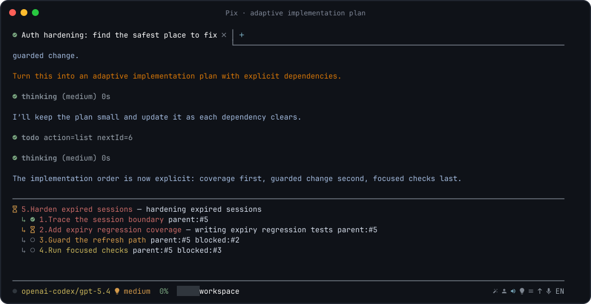
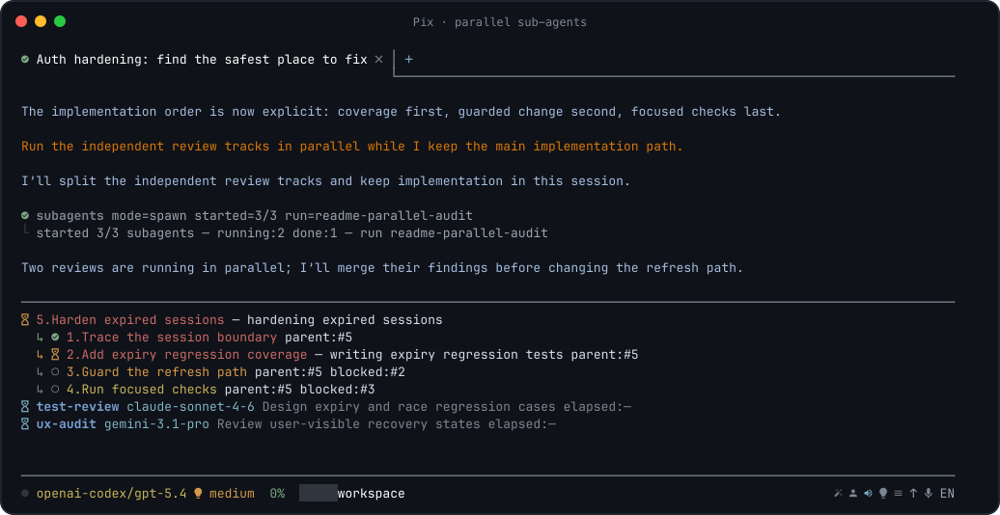

<!-- pix:wiki-report {"version":1,"checkedAt":"2026-10-30T23:02:27.031Z","result":{"path":"wiki/overview.md","documentHash":"7df40208f993f3026ceadf62ab875ac53a6bc6637d205cc1f2bc4ed89d4be684","modelRef":"zai/glm-5.3-flash","reportLanguage":"ru","checkedSources":12,"conflicts":[],"uncertainties":[{"draft":{"path":"wiki/overview.md","quote":"**Platform support:** Pix Desktop currently supports **macOS on Apple Silicon\nonly**. Windows and Linux Desktop packages are not currently published or\nplatform-validated in CI.","startLine":93,"endLine":95},"existing":{"path":"wiki/getting-started/llm-install.md","quote":"- **macOS:** mount the DMG and copy the app to `~/Applications` or\n  `/Applications` according to available permissions;\n- **Windows:** run the NSIS installer;\n- **Linux Debian/Ubuntu:** the `.deb` is preferred when package installation is\n  appropriate;","startLine":129,"endLine":133},"explanation":"В том же источнике ранее сказано устанавливать Desktop только на macOS и считать Windows/Linux-ассеты legacy tooling, а раздел 6 даёт инструкции по установке NSIS-инсталлятора и .deb/AppImage. Чтобы решить, противоречит ли этот раздел утверждению черновика об отсутствии публикуемых пакетов, нужно знать, относятся ли инструкции раздела 6 к устаревшему/legacy-сценарию или к актуальному контракту установки."}],"reviewedSources":[{"path":"wiki/development/release/guide.md","quote":"# Release and update verification\n\nUse this checklist before publishing a Pix GitHub Release so installs work on macOS, Linux, and Windows and the `pi-tools-suite` extension payload is included.\n\n**Desktop support is currently macOS only.** Windows/Linux Desktop packaging\nremains in the tooling but is not a supported product or a current Desktop\nvalidation requirement. TUI support on those platforms is unchanged.\n\n## Downloadable TUI and Desktop releases\n\nOne stable `vX.Y.Z` tag produces a **published GitHub Release** containing portable\nTUI and Desktop installers. The contract is in\n[`wiki/development/release/release-distribution.md`](release-distribution.md).\n\n| Target | TUI | Desktop |\n| --- | --- | --- |\n| Windows x64 | `.zip` with `pix.cmd` | Legacy tooling only; unsupported |\n| macOS Apple Silicon | `.tar.gz` with `pix` | `.dmg` |\n| Linux x64 | `.tar.gz` with `pix` | Legacy tooling only; unsupported |\n\nEach download contains its own Node.js runtime and dependencies. The bundled\nruntime version matches the Node selected from `PATH` on that native release\nbuilder. Users do not need Node/npm to launch Pix. Keep the complete TUI directory together and run its\nlauncher from a terminal; add that directory to PATH or symlink `pix` on Unix.\nDesktop includes ACP and does not require an npm-installed Pix. Git, shells,\nproject runtimes, optional helpers and provider credentials remain separate.\nmacOS release packages require 13.5 or newer.\nLinux bundles are built on Ubuntu 22.04; do not advertise support for older\nglibc/WebKit environments without running additional compatibility tests.\n\n### Local build\n\nSelect a supported Node and npm on PATH, install Rust and the platform's\n[Tauri build prerequisites](https://v2.tauri.app/start/prerequisites/), then run:\n\n```bash\nnpm ci --ignore-scripts\nnpm ci --prefix acp --ignore-scripts\nnpm ci --prefix desktop --ignore-scripts\nnpm run release:build\n# Or specify this machine's target:\nnpm run release:build -- macos-arm64\n# Only the portable TUI archive:\nnpm run release:build -- macos-arm64 --tui-only\n```\n\nAfter changing Node major versions, remove every repository `node_modules`\ntree and rerun the corresponding `npm ci` commands before building. Native\naddons must be rebuilt for the active Node ABI.\n\nUse the corresponding native machine/runner for each target. Cross-host packaging\nis rejected because native modules must match both CPU and OS. Output is under\n`.artifacts/releases/\u003ctarget\u003e/assets/`. Builds test the real unpacked package and\nthe relocated/installed GUI, including an app copied from a mounted read-only DMG.\nThe release builder sets `CI=true` even locally so DMG creation does not need Finder\nautomation permissions. Development commands (`dev:desktop`, `watch:all`,\n`build:desktop`) remain separate and do not make distributable bundles.\n\nmacOS TUI and Desktop payloads both include `helpers/macos-accessibility`,\ncompiled during preparation and signed with `APPLE_SIGNING_IDENTITY` along with\nthe runtime. Use the **same Apple Developer ID certificate** for subsequent\nreleases if UI-QA Accessibility/Screen Recording grants should survive helper\nupdates. Without that identity, builds are ad-hoc signed for local validation;\nan updated helper can require new user consent. This is separate from the\nTauri updater signing key. Release smoke verifies the helper's code signature\nand stable identifier in both payload variants. Users must grant the helper\nitself access in macOS System Settings, not just Pix Desktop.\n\nTo iterate on the Desktop wrapper after preparing its runtime, use\n`npm run release:build:desktop -- \u003ctarget\u003e`; rebuild the full release after any\nPix/ACP/dependency change. `release:smoke` and `release:smoke:desktop` rerun checks\nagainst already built artifacts. These harnesses create temporary user profiles;\ndo not invoke `verify.mjs` or the native diagnostic directly with your real HOME.\n\nDesktop release builds also require the Tauri updater signing private key. CI\nreads it from the `TAURI_SIGNING_PRIVATE_KEY` repository secret. A local release\ncan provide that environment variable or `TAURI_SIGNING_PRIVATE_KEY_PATH`; the\nrelease helper also recognizes the ignored local path\n`.artifacts/release-signing/pix-updater.key`. Never commit the private key, and\nkeep a durable secure backup. This checkout's rotated key is stored at\n`~/.config/pix/release-signing/pix-updater.key` (owner-only directory and files);\nuse `TAURI_SIGNING_PRIVATE_KEY_PATH=\"$HOME/.config/pix/release-signing/pix-updater.key\"`\nfor local builds. Keep a separate, securely backed-up copy outside build artifacts\nand the repository; if this key is lost, the public key and Actions secret cannot\nrecover it. Do not print the private key or include it in logs or artifacts.\n\nPrefer keeping the durable key outside `.artifacts` and supplying its path via\n`TAURI_SIGNING_PRIVATE_KEY_PATH`: deleting build artifacts must not delete your\n","startLine":1,"endLine":88},{"path":"wiki/configuration/guide.md","quote":"as the New Conversation draft picker. Selecting `Auto` from an existing\nconversation does not re-route that conversation; Pix opens or reuses a New\nConversation draft and enables Auto there.\n\nDesktop exposes the same fields in Settings → Models, including editable tier\nrows. The router provider needs valid credentials independently of the target\ntier providers.\n\n## Desktop configuration\n\nPix Desktop has an independent profile:\n\n```text\n~/.config/pi/pix-desktop.jsonc\n\u003cworkspace\u003e/.pi/pix-desktop.jsonc\n```\n\nSchema:\n\n```text\nhttps://unpkg.com/pi-ui-extend/schemas/pix-desktop.json\n```\n\nDesktop settings cover Desktop/ACP behavior such as model defaults, model-picker\nvisibility/preferences, prompt helpers, voice, external editor and Source\nControl review/commit-message/CI-repair models. Leaving the Source Control\n**CI fix model** unset makes **Fix with AI** use the normal default model for\nits new repair session. TUI renderer/theme/tool-row settings remain\nin `pix.jsonc`. **Settings → Desktop → General → Logs panel** controls the\noptional Logs sidebar (`desktop.logPanelEnabled`, default `false`). It takes\neffect after a successful save; hiding the panel stops monitoring but does not\ndisable log collection. See [Unified diagnostic logging](../operations/logging.md)\nfor coverage, snapshot limits and privacy guidance.\n\n`desktop.projectIcon.model` optionally selects the OpenRouter image model used\nto generate project logos (default `google/gemini-2.5-flash-image`). A project\nvalue overrides the global Desktop profile. See [Pix Desktop](../desktop/guide.md) for\nwhat project information is sent for logo generation.\n\n**Settings → Desktop → General → Notifications** controls alerts for completed\nagent work, questions, pauses and errors. `desktop.notifications.enabled`\ndefaults to `true`. **Sound only (no popups)** (`desktop.notifications.usePix`,\ndefault `false`) replaces macOS notifications with a short sound, including\nwhen Pix is in the background. No in-app or system notification popup appears\nin this mode, and OS notification permission is not needed. The user and\nproject Desktop config can override both settings, and saves apply to\nsubsequent events.\n\n### Desktop Universal Search: Auto intent\n\nThe Universal Search dialog (`Cmd+Shift+F`) offers **Auto · Jev** (default),\n**Search**, and **RAG**. Search never makes an intent-router request. Auto\nuses OpenRouter Jev Latest Decisions to choose between finding results and\ngenerating a source-grounded answer. Classification happens only after the\nuser submits a query, never as the user types.\n\nAuto requires the saved OpenRouter credential used by Pix. **Only the search\nquery** is sent to OpenRouter for this decision; project files, history,\nindexed snippets and workspace paths are not uploaded by the classifier.\nProvider charges may apply. If the key or Jev is unavailable, Auto falls back\nto regular Search. This is separate from the `modelRouting` Auto model picker and\nfrom semantic settings/session-title/task consent preferences.\n\n### Desktop Universal Search: task embeddings\n\nTask search is always available locally from `.pi/tasks.sqlite`, including\ntask titles, descriptions, parent/related tasks, file and artifact paths,\nattachment names, status, priority, linked session and assigned model.\nNeither a saved OpenRouter key nor a repository-search index is required for those matches.\n\nUnder Desktop Settings → Search, `search.tasksSemanticEnabled` is a separate,\n**off-by-default** opt-in. When enabled, an explicit Tasks search can send\nproject-task **titles and descriptions** (up to 2,000 characters per task), saved\nplan paths/titles and plan Markdown (chunked, up to 64 chunks of 2,000 characters\nper plan), and the query\nto OpenRouter for semantic embeddings, which may incur charges. Plan content is\nuploaded when this setting is enabled. Other task fields and attachment contents\nare excluded from task embedding inputs. The first search indexes up to 64 new task texts; later\nsearches continue the index. The durable cache is kept under\n`.pi/search/index.sqlite`, not in the authoritative task database. Task status,\npriority, links and model changes do not trigger re-embedding when the title\nand description remain unchanged. Disabling stops future uploads but does not\ndelete previously paid local vectors. RAG source/model calls have their own\nseparate disclosure and consent.\n\n","startLine":147,"endLine":231},{"path":"wiki/index.md","quote":"# Pix Wiki\n\nPix is a workspace-first coding UI for Pi, available as a terminal TUI and a\nnative **macOS Apple Silicon** Desktop app. It brings persistent project\nsessions, readable agent activity, Source Control, repository intelligence,\ntasks and bundled agent tools into one workbench.\n\n## Start here\n\n- **New user:** [project overview](overview.md) → [install and troubleshoot](getting-started/index.md) → [Desktop](desktop/guide.md) or [TUI](tui/guide.md).\n- **Contributor or agent:** [architecture](architecture/index.md) → [development and verification](development/index.md) → the relevant feature contract → [decision rationale](decisions/index.md).\n- **Looking for a requirement:** use a subject below or the [complete contract catalogue](reference/contracts.md). An as-is spec, an experiment and a proposal are not interchangeable.\n\n## Product and subsystems\n\n- [Desktop workbench](desktop/index.md) — navigation, Wiki, conversations, rendering and integrations; [visual design rules](desktop/design.md).\n- [Terminal UI](tui/index.md) — sessions, input, commands and memory/concurrency diagnostics.\n- [Configuration and model routing](configuration/index.md) · [providers and authentication](providers/index.md) · [usage and quotas](usage/index.md).\n- [Repository search and knowledge](search/index.md) — native project discovery and agent workflows.\n- [Tools](tools/index.md) and [sub-agents](tools/agents/index.md) — suite, APIs, roles and lifecycle.\n- [Context and continuity](context/index.md) — prompt composition, DCP, recovery and statistics.\n- [Work management](work-management/index.md) — saved tasks, session todos and resource registry.\n- [Assistant features](assistants/index.md) — voice, brainstorm and the opt-in Observer.\n- [Markdown, diagrams and links](rendering/index.md).\n\n## Engineering and project memory\n\n- [Architecture](architecture/index.md) — components, ACP and lifecycle boundaries.\n- [Development](development/index.md), [testing and QA](development/testing/index.md), [CI and releases](development/release/index.md).\n- [Safety, diagnostics and operations](operations/index.md), including unresolved [incident observations](operations/incidents/index.md).\n- [Decision records](decisions/index.md) — accepted choices, alternatives and supersession.\n- [Research and proposals](proposals/index.md) — not approved implementation contracts.\n- [Archive](archive/index.md) — historical MVP, removed tool and superseded decision references.\n- [Wiki maintenance](maintenance/index.md), [migration map](maintenance/migration-map.md) and [known conflicts](maintenance/known-conflicts.md).\n- [Reference catalogue](reference/index.md) — specifications and the preserved original contract overview.\n\n## Documentation status\n\nThe migration preserves source languages, requirements, examples, status and metadata.\nIt does not newly certify every behavior claim. Read each page’s scope and lifecycle\nbefore changing code. [Known conflicts](maintenance/known-conflicts.md) remain explicit\nuntil an evidence-backed follow-up reconciles their original texts.\n","startLine":1,"endLine":42},{"path":"wiki/getting-started/llm-install.md","quote":"# LLM installation command\n\n\u003c!-- markdownlint-disable MD013 --\u003e\n\nThis document is intentionally written as an execution contract for a coding\nagent. It installs Pix from **GitHub Releases**, not from a package registry.\n\n## Copy/paste command for an LLM\n\nPaste this into an agent that can use a terminal and the web:\n\n```text\nInstall and configure the latest stable Pix from https://github.com/dnaroid/pix\nfor this machine. Follow\nhttps://github.com/dnaroid/pix/blob/master/wiki/getting-started/llm-install.md exactly.\n\nDetect the current OS and CPU first. Preserve all existing Pi/Pix configuration,\ncredentials, sessions and project .pi directories. Inventory every existing\n\"pix\" and \"pi-ui-extend\" launcher before changing PATH. Remove only confirmed\nlegacy Pix wrappers/package-manager installs after inspecting what they target.\nDo not remove a separate \"pi\" CLI or user configuration.\n\nInstall from GitHub Releases and verify the selected asset against SHA256SUMS.\nPix Desktop is currently supported on macOS only; install it only on macOS and\ntreat Windows/Linux Desktop assets as legacy tooling, not a supported product.\nUnless I explicitly requested only one frontend, install the portable TUI and\n(on macOS) Pix Desktop when this OS/CPU has official release assets. Reuse\nexisting user configuration rather than overwriting it. Run the documented\nhealth/version checks afterwards and report exactly what was installed,\nremoved, preserved, and any manual authentication or OS permission step that\nremains.\n```\n\n## Agent execution contract\n\n### 1. Detect the platform\n\nDetermine OS and CPU from the machine itself, not from assumptions.\n\nSupported stable release targets are:\n\n- Linux x64 (`x86_64` / `amd64`);\n- macOS Apple Silicon (`arm64` / `aarch64`);\n- Windows x64 (`AMD64` / `x86_64`).\n\nIf the detected target is unsupported, stop before downloading a foreign binary\nand offer the source-development path in [Development](../development/guide.md).\n\n### 2. Inventory and protect user state\n\nBefore changing anything:\n\n1. locate all `pix` and `pi-ui-extend` commands;\n2. inspect symlink/wrapper targets;\n3. inspect relevant global package-manager entries when those tools exist;\n4. record existing TUI and Desktop install locations;\n5. confirm the following user data is preserved:\n   - `~/.config/pi/`;\n   - `~/.pi/agent/`;\n   - project `.pi/` directories;\n   - provider/registry credentials and session files.\n\nDo not print secret values while inspecting configuration.\n\n### 3. Remove only confirmed legacy Pix launchers\n\nLegacy means an old Pix/`pi-ui-extend` package-manager install, source-checkout\nwrapper, or redundant user launcher that would conflict with the new release.\n\nSafe examples after inspection:\n\n- uninstall a confirmed global `pi-ui-extend` package with the package manager\n  that owns it;\n- remove/replace a user-owned `~/.local/bin/pix` symlink after confirming it\n  points to the old payload;\n- replace an old Pix Desktop application/desktop entry with the new release.\n\nNever:\n\n- recursively delete `~/.config/pi` or `~/.pi`;\n- delete project `.pi` directories;\n- remove an unrelated/separately managed `pi` command;\n- delete an executable merely because its filename is `pix`.\n\nIf ownership cannot be established, leave the item in place and report the\nconflict.\n\n### 4. Resolve the latest stable GitHub Release\n\nUse GitHub Releases for `dnaroid/pix`. Prefer `gh` when already installed;\notherwise use the GitHub Releases API / normal HTTPS download.\n\nSelect assets by the **exact detected target**:\n\n| Target | TUI asset | Desktop asset |\n| --- | --- | --- |\n| Linux x64 | `pix-tui-*-linux-x64.tar.gz` | legacy tooling only; do not install |\n| macOS arm64 | `pix-tui-*-macos-arm64.tar.gz` | `pix-desktop-*-macos-arm64.dmg` |\n| Windows x64 | `pix-tui-*-windows-x64.zip` | legacy tooling only; do not install |\n\nAlso download `SHA256SUMS`.\n\nDo not derive trust from the filename alone. Compute SHA-256 locally and require\nan exact filename/digest match in `SHA256SUMS` before installing.\n\n### 5. Install the TUI transactionally\n\nUse a stable per-user directory. Recommended locations:\n\n- macOS/Linux: `~/.local/opt/pix`;\n- Windows: `%LOCALAPPDATA%\\Pix\\tui`.\n\nExtract into a temporary sibling directory first. Confirm the launcher and\nrelease payload are present. Only then replace the old application directory.\nKeep a rollback copy until the new launcher passes its version/health check.\n\nExpose the launcher:\n\n- macOS/Linux: point `~/.local/bin/pix` at the new `pix`;\n- Windows: add the TUI directory to the user PATH when needed.\n\nDo not flatten the archive: the launcher expects its bundled runtime/dependencies\nto remain beside it.\n\n### 6. Install Pix Desktop\n\nUnless the user requested TUI-only:\n\n- **macOS:** mount the DMG and copy the app to `~/Applications` or\n  `/Applications` according to available permissions;\n- **Windows:** run the NSIS installer;\n- **Linux Debian/Ubuntu:** the `.deb` is preferred when package installation is\n  appropriate;\n- **other Linux x64:** place the AppImage in a stable user-owned directory such\n","startLine":1,"endLine":134},{"path":"wiki/tui/guide.md","quote":"- `/export` / `/import` — move sessions through HTML/JSONL;\n- `/share` — publish a secret GitHub gist;\n- `/compact` — manually summarize older context;\n- `/delete` — permanently delete a session after confirmation.\n\n`maxProjectSessions` controls automatic per-project session retention; `0`\nkeeps sessions indefinitely.\n\n## Bundled pi-tools-suite\n\nPix links the bundled suite into the active Pi agent directory when safe. An\nexisting non-symlink installation is preserved.\n\nMajor capabilities include:\n\n| Area | Modules / behavior |\n| --- | --- |\n| Parallel work | `async-subagents`, presets, fallback routing, `/ultrawork`, `/hyperplan` |\n| Repository search | Native Code/Knowledge retrieval via `project_search` |\n| Structural edits | `ast-grep` |\n| Feedback | LSP diagnostics and comment checks |\n| Planning | hierarchical durable todos |\n| Context | DCP compression/pruning |\n| Web | local/cloud web-search integrations |\n| Providers | usage, Antigravity auth, OpenCode credential import |\n| Reusable resources | prompt commands, Git-backed Registry, session naming |\n| Recovery | bounded session overview/search/section tools |\n| Payload hygiene | truncation normalization and opt-in credential firewall |\n\nOptional modules activate only when their host requirements are available.\nBroken module imports/factories are skipped with a startup warning instead of\nremoving the whole suite. This does not certify unfinished feature behavior or\nundo arbitrary initialization side effects; see\n[module loading](../tools/pi-tools-suite-module-loading.md).\n\nAdaptive plans keep dependencies, blockers, ownership and the active step\nvisible:\n\n\n\nParallel sub-agents report live status without taking over the main session:\n\n\n\nUseful suite commands include `/todos`, `/sub-status`, `/sub-stop`,\n`/ultrawork`, `/hyperplan`, `/usage`, `/dcp`, `/opencode-import`, and\n`/antigravity-add-account`.\nThe Git-backed resource Registry is available only in Pix Desktop.\n\n## Command map\n\n| Area | Commands |\n| --- | --- |\n| Renderer/resources | `/settings`, `/hotkeys`, `/reload`, `/changelog`, `/update` |\n| Models | `/model`, `/default-model`, `/scoped-models`, `/thinking`, `/default-thinking`, `/autocomplete` |\n| Project context | `/no-context-files`, `/compact` |\n| Prompt workflow | `/enhance`, `/queue`, `/copy` |\n| Git | `/code-review`, `/commit-message` |\n| Sessions | `/new`, `/new_tab`, `/resume`, `/name`, `/session`, `/search`, `/history`, `/jump`, `/tree` |\n| Branching/files | `/fork`, `/clone`, `/delete`, `/export`, `/import`, `/share` |\n| Status/process | `/usage`, `/quit`, `/exit` |\n\nUse `/hotkeys` and the live `/` picker as the authoritative command/key\nsummary for the installed version.\n\n## Workspace undo\n\nPix records supported agent file mutations against the user message that started\nthem. Use the message action **Undo changes** to rewind that branch and restore\nrecorded workspace changes.\n\nWorkspace undo is a safety net, not a replacement for version control.\n","startLine":98,"endLine":169},{"path":"wiki/development/desktop.md","quote":"# Pix Desktop\n\nLightweight Tauri 2 + Svelte 5 client for Pix. It runs `pix-acp` as an\nisolated child process and communicates with it over ACP JSON-RPC.\n\n## Platform support\n\nPix Desktop is currently supported and released only on **macOS Apple Silicon**.\nWindows and Linux Desktop packages are intentionally not produced or\nplatform-validated in CI for now. This does not affect Pix TUI support on\nWindows or Linux.\n\n## Visual direction\n\nThe desktop client follows the terminal renderer's information hierarchy:\nproject-scoped sessions are horizontal tabs, the transcript remains visually\nuninterrupted, thinking and tool activity stay compact, and model, thinking,\nconnection, and workspace controls live in the bottom status area. Native\ndesktop controls remain available without turning the interface into a\nsidebar-and-chat-bubble layout.\n\n## Local setup\n\nFrom the repository root:\n\n```sh\nnpm --prefix acp install\nnpm --prefix desktop install\nnpm run dev:desktop\n```\n\nFor repository-wide development, run `npm run watch:all` from the repository\nroot instead. It watches Pix, pix-acp, the bundled tool suite, and both Desktop\nlayers. Desktop is restarted only after a successful build; on a build error,\nthe last working process stays open.\n\n`dev` and `build` compile `acp/dist/main.js` before Tauri starts. The current\nMVP expects `node` to be available on `PATH`; pix-acp resolves pi's bundled RPC\nentry from its pinned npm dependency. Packaging Node and pix-acp as a signed\nsidecar is intentionally deferred.\n\nFor non-standard development setups, set `PIX_ACP_NODE_BINARY` to the Node\nexecutable and/or `PIX_ACP_ENTRY` to a built pix-acp entry point.\n\n## macOS title bar quirks\n\nThe project selector lives in a custom title bar (`ProjectTitlebar.svelte`,\n36px tall) rendered under `titleBarStyle: \"Overlay\"` + `hiddenTitle`. Two\nTauri 2/macOS traps are easy to reintroduce:\n\n- **Window dragging stops working.** `data-tauri-drag-region` sends the\n  `window.start_dragging` IPC, which is *not* part of `core:window:default`\n  (and therefore not part of `core:default`). The capability set in\n  `src-tauri/capabilities/default.json` must explicitly include\n  `core:window:allow-start-dragging` (plus\n  `core:window:allow-internal-toggle-maximize` if double-click-to-zoom on the\n  title bar should keep working). Without the permission the drag silently\n  does nothing — there is no visible error in the UI.\n- **Traffic lights render 4px higher than configured.** macOS draws the\n  12px traffic-light dots 4px above the `trafficLightPosition` frame origin\n  (NSButton frame inset). With a 36px header, `y: 16` puts the visible dots\n  at y 12..24, centered on the row; `y: 12` makes them sit 4px too high and\n  misaligned with the selector. If the header height changes, recompute as\n  `y = (headerHeight - 12) / 2 + 4`.\n\nVerification recipe (real window, macOS): see `.pi/skills/tauri-window-qa`;\nmeasure the dot bounds from a screenshot (red/green pixel scan) and compare\nwith the header row border; drag via a CGEvent mouse-down/move/up sequence on\nempty header space and confirm the window position changes while the content\narea stays inert.\n\n## Checks\n\n```sh\nnpm --prefix desktop run check\nnpm --prefix desktop test\ncargo check --manifest-path desktop/src-tauri/Cargo.toml\n```\n","startLine":1,"endLine":78},{"path":"wiki/getting-started/installation.md","quote":"Verify:\n\n```powershell\npix.cmd --help\npix.cmd install --check\npix.cmd update --check\n```\n\n## Pix Desktop\n\nPix Desktop is a native Tauri application with its own bundled Pix/ACP runtime;\nthe TUI is not required.\n\n- **macOS:** open the `.dmg` and copy Pix Desktop into Applications or\n  `~/Applications`. Release packages require macOS 13.5 or newer.\n- **Windows/Linux:** not currently supported. Packaging assets exist only as\n  legacy tooling; do not install them for a supported Desktop setup.\n\nDesktop has a separate configuration profile:\n\n```text\n~/.config/pi/pix-desktop.jsonc\n```\n\nProject overrides live at `\u003cworkspace\u003e/.pi/pix-desktop.jsonc`. See\n[Pix Desktop](../desktop/guide.md) for features, first-run behavior and Linux-specific\ntroubleshooting.\n\n## Checksums\n\nOn Linux:\n\n```bash\nsha256sum \u003cdownloaded-file\u003e\n```\n\nOn macOS:\n\n```bash\nshasum -a 256 \u003cdownloaded-file\u003e\n```\n\nOn Windows PowerShell:\n\n```powershell\nGet-FileHash \u003cdownloaded-file\u003e -Algorithm SHA256\n```\n\nCompare the digest with the exact filename entry from the release's\n`SHA256SUMS` file before installing/replacing the payload.\n\n## First-run setup\n\nThe TUI health check is non-mutating:\n\n```bash\npix install --check\n```\n\n`pix install` / `pix setup` can additionally install the recommended Nerd\nFont, install the standalone `pi` CLI when missing, create non-secret config\ntemplates and print credential-aware next steps. It never imports provider\ncredentials automatically.\n\nIn an interactive terminal `pix install` also runs a model setup wizard. It\nlists the models available to your configured providers, suggests `main`,\n`fast` and `strong` roles, and after confirmation writes them to `pix.jsonc`,\n`pi-tools-suite.jsonc` (frontier models, sub-agent role models and per-slot\noverrides) and, when it exists, `pix-desktop.jsonc`. After the roles it asks\n\"Customize individual models (fallbacks, lookup, per-feature)?\" and walks every\nmodel slot — Enter keeps the current value and `-` clears an optional slot such\nas a fallback or the vision-only Lookup models, which accept only vision-capable\nentries — then asks \"Configure search embeddings?\" and writes `search.embedding`\n/ `search.rerankerModel` to `pi-tools-suite.jsonc` on request. The Strong\nmodel becomes the primary frontier model; existing `frontierModels` entries keep\ntheir flags and aliases. Shipped defaults contain no model ids; the wizard is skipped when\nmodels are already configured or stdin is not a TTY;\nrun `pix install --models` to repeat it.\n\nPix Desktop offers the same choice (Main / Fast / Strong) as a first-run dialog when no\ndefault model is configured and providers are connected. Reopen it from\n**Settings → Models → Edit in wizard…**; a manual run starts with an **In use**\npage that replaces a model everywhere it is configured. The Desktop dialog\nmatches the TUI wizard: both can override individual model slots and set optional\nfallback, vision Lookup and search-embedding settings (see\n[Pix Desktop](../desktop/guide.md)); skipping the first run is remembered, while cancelling\na manual run changes nothing. Both write the same config files, including\n`search.embedding` / `search.rerankerModel` into `pi-tools-suite.jsonc` on request.\n\nFor provider setup and configuration details, see\n","startLine":114,"endLine":203},{"path":"wiki/decisions/0046-task-scoped-knowledge-completion.md","quote":"# 0046 — Task-scoped knowledge audit completion\n\n- Status: superseded by [0067](0067-final-documentation-maintenance.md)\n- Recorded / decided: 2026-10-05\n- Owner / approval evidence: user approved the task/global separation in this\n  conversation with “да, сделай это”.\n- Governing specs: [repository knowledge workflow](../search/repo-knowledge-agent-workflow.md),\n  [todo finalization reminder](../work-management/todos/todo-repo-knowledge-finalization.md)\n- Replaced by: [0067 — Final documentation maintenance without knowledge-state gates](0067-final-documentation-maintenance.md).\n  The historical rationale below is retained; the decision-history policy in\n  [0002](0002-agent-owned-decision-history.md) is unchanged.\n\n## Context\n\nParallel agents share a project-wide knowledge dirty signal, but each owns only\nits supplied task changes. Completion must not depend on unrelated work.\n\n## Observations and sources\n\n- User-reported in this conversation: an agent's audit todo often remains open\n  after its own review because other agents keep the knowledge base dirty. No\n  durable incident artifact or measured frequency was supplied.\n- Verified in [todo/index.ts](../../external/pi-tools-suite/src/todo/index.ts):\n  the finalization reminder is advisory; it does not run `idx` or gate completion.\n- The prior auditor wording already recognized that a remaining global `yes`\n  could be unrelated, but parent/catalog/todo instructions did not explicitly\n  separate todo completion from global cleanliness. Model compliance remains\n  instruction-based, not a runtime guarantee.\n\n## Decision\n\nReturn task audit passed/blocked independently from global dirty yes/no/unknown.\nClose the audit todo when task evidence, genuinely affected specs, required\ndependency coverage and eligible acknowledgments are complete. Report residual\nglobal dirtiness/errors separately; an unclassified `yes` alone is not a blocker\nand cannot be attributed to other agents without evidence. Preserve blockers\nfor missing task coverage, drift and edits to reviewed specs/dependencies,\nincluding shared files. Never acknowledge unrelated specs or claim the whole\nknowledge base is clean merely because one task passed.\n\nApply this to the auditor, parent catalog, repo-audit fallback and todo reminder.\nKeep Desktop's project-wide dirty indicator and global AI review unchanged.\n\n## Alternatives\n\n- Require global `no`: couples independent tasks and can prevent completion\n  indefinitely while other agents work.\n- Bulk-acknowledge to clear `yes`: would certify unreviewed work.\n- Ignore all remaining dirtiness or concurrent edits: hides missing task\n  evidence and stale reviews of shared dependencies.\n- Introduce task receipt storage/new idx commands: unnecessary for this\n  instruction-level issue; would require a separate CLI/concurrency contract.\n\n## Consequences\n\nExpected: independent tasks can finish without waiting for global cleanliness.\nResidual global state stays visible and unresolved task evidence still blocks\nsuccess. Deterministic tests verify instruction delivery and advisory todo\nbehavior; they cannot prove every model will comply. Existing acknowledgment\ncommands do not introduce new atomic cross-agent snapshot guarantees here.\n\n## Revisit when\n\nModels still conflate verdicts, shared-dependency races cannot be resolved with\nre-review, or task-local machine-readable receipts become necessary.\n","startLine":1,"endLine":65},{"path":"wiki/desktop/guide.md","quote":"  or project setting creates only the required `.pi` storage on demand. Merely\n  opening/reading a workspace does not create `.pi`. Creating a new `.pi`\n  appends `/.pi/` to the root `.gitignore` while preserving existing rules and\n  newline style; existing `.pi` directories are not retroactively ignored.\n  Initialization does not import, read or remove old JSONC task files.\n- Search indexes reports local/semantic store state without initializing or\n  repairing indexes.\n\n## Configuration\n\nDesktop does not inherit the TUI's `pix.jsonc`.\n\nUser configuration:\n\n```text\n~/.config/pi/pix-desktop.jsonc\n```\n\nProject override:\n\n```text\n\u003cworkspace\u003e/.pi/pix-desktop.jsonc\n```\n\nSchema:\n\n```text\nhttps://unpkg.com/pi-ui-extend/schemas/pix-desktop.json\n```\n\nThe Desktop profile contains settings consumed by Desktop/ACP, including model\ndefaults, prompt helpers, visible models, external editor, voice input and Git\nreview/commit-message model preferences. TUI-only renderer/theme settings stay\nin `pix.jsonc`.\n\nProject settings (name color and logo) open from **Project settings…** at the\nbottom of the project switcher menu, or by right-clicking the project badge in\nthe titlebar. They can assign a logo using **Initials** or **Image**. Images may\nbe selected with the native file chooser or generated through OpenRouter; they\nremain previews until saved. A saved image is stored as `.pi/project-icon.png`,\n`.jpg`, `.webp`, `.gif` or `.svg` (content-detected, up to 4 MB) and referenced\nby `.pi/workspace.jsonc`. Generation uses `OPENROUTER_API_KEY` or the OpenRouter\nkey in Pi's `auth.json`; it sends the project name, optional prompt (up to 1000\ncharacters) and up to the first 1000 README characters to the provider. The\ndefault image model is `google/gemini-2.5-flash-image`; configure\n`desktop.projectIcon.model` in global or project `pix-desktop.jsonc` to override\nit. `.pi` cleanup preserves the canonical icon files. See the\n[project identity contract](workbench/desktop-project-titlebar.md).\n\nSee [Configuration and accounts](../configuration/guide.md) for provider and voice setup.\n\n## BTW side questions\n\nOpen **⋯ → Side question (BTW)** in the composer to ask about the current task\nin a resizable pane on the right. `/btw` also opens it; `/btw question` sends a\nquestion there. Both work while the main agent is running or paused. Opening the\npane alone does not call a model or move the main draft and attachments.\n\nBTW supports follow-up questions and Markdown/code answers. Its model/effort\nbutton opens the same **Model + Thinking** selector as the statusbar, using your\nDesktop visible-model list rather than showing every model. **Manage** edits\nthat shared list. Choose a model and its supported thinking level, then Apply;\nthe selection affects only the next BTW question, never the main agent.\n**Same as main session** inherits both the parent's resolved model and effort;\n**Use main** restores this mode. Applied effort choices are remembered per model\nonly while the side chat exists; they do not change the main model defaults.\n**Add selected text** explicitly includes a selected transcript/file\nexcerpt. BTW has no tools: it cannot independently read files, search or run tests.\nEach question uses current completed parent context; shortened context is labelled.\n\n**Stop** stops only the side response. Hiding the pane keeps its temporary\nhistory, draft and reading position; reopening restores them. Each parent session\nhas its own side conversation. **New conversation** clears it. Closing/replacing\nthe parent runtime, reconnecting or exiting discards the temporary conversation;\nit is not saved into the main chat or restored after restart.\n\nUse **Copy** or **Insert** on an answer to reuse it. Insert requires an empty main\ncomposer with no attachments and only writes a draft; it never sends it. Model\nusage still counts towards the original session. See the [BTW contract](conversations/desktop-btw.md).\n\n## Observer (experimental)\n\nThe **binoculars** on the right of the statusbar are grey when Observer is off and primary-colored\nwhen enabled, except static amber binoculars while blocked by an Observer budget limit.\nThe tooltip and popup say «Достигнут лимит проверок» and show the earliest known\n","startLine":131,"endLine":215},{"path":"wiki/development/extensions.md","quote":"# Extension authors\n\n\u003c!-- markdownlint-disable MD013 --\u003e\n\nPix runs on the Pi SDK and exposes a renderer-facing UI context for extensions.\nIt is not a separate agent protocol that requires extensions to abandon Pi's\nsession/tool model.\n\n## SDK entry points\n\n```ts\nimport type { PixExtensionUIContext } from \"pi-ui-extend\";\n// or\nimport type { PixExtensionUIContext } from \"pi-ui-extend/sdk\";\n```\n\nPublished declarations are generated at:\n\n```text\ndist/sdk.d.ts\n```\n\n## UI surface\n\nPix implements the Pi extension UI surface used for:\n\n- notifications and keyed toasts;\n- widgets and content above the input;\n- menus and dialogs;\n- custom full-screen UI;\n- editor text;\n- terminal input hooks;\n- theme helpers;\n- status updates.\n\nExtensions should use public Pi/Pix SDK contracts rather than assuming stock\nrenderer internals.\n\nWhen the same extension can run without an interactive renderer, protect UI-only\npaths with `ctx.hasUI`.\n\n## Bundled extensions\n\nThe bundled [pi-tools-suite](../tools/suite.md) is a useful\nreference for extensions that need to work in Pix while remaining usable in\nother Pi contexts. Suite-spawned sub-agents intentionally use a smaller isolated\nextension set rather than inheriting the complete parent UI environment.\n\nPix also bundles the TUI-only `choice-actions` extension. It advertises optional\nnext-step checklists in the system prompt and presents valid `pix-actions`\nblocks from the final assistant message as a selectable widget above the editor.\nThe shared contract and Desktop behavior are documented in the\n[HTML Sandbox specification](../desktop/rendering/desktop-html-sandbox.md#quick-choice-actions).\n\n## Development\n\nSee [Development](guide.md) for the source checkout and build/test\ncommands. Renderer/SDK behavior changes should be tested against the public\nextension contract rather than only against one visual path.\n","startLine":1,"endLine":59},{"path":"wiki/development/guide.md","quote":"The report separates preflight and full-gate runs, then groups failed test\nnames, error-code signatures, and observed Bun suite durations by OS.\nIt does not infer GitHub job status from a\nsuccessful gate summary: check the GitHub run separately for cancelled jobs\nor post-job timeouts. It also cannot prove flakiness from a single failure;\nrepeat a focused lifecycle regression on its native OS with Bun 1.4.2 rather\nthan repeatedly running the entire CI matrix.\n\n## TUI development\n\n```bash\nnpm run dev -- --cwd /path/to/project\nnpm run check\nnpm run test:tools-suite\nnpm run build:tools-suite\nnpm run build:pix\n```\n\nThe bundled pi-tools-suite runtime is built from source by\n`npm run build:tools-suite`. `node scripts/sync-pi-tools-suite.mjs` rebuilds it\nbefore mirroring source and runtime outputs to the live extension; pass\n`--check` to inspect drift without building or writing.\n\nThe tools-suite's default Bun command uses `--isolate` to keep per-file module\nmocks from leaking into unrelated tests. For the complete suite use the\nCI-pinned Bun 1.4.2; for multi-file focused Bun runs,\nalso pass `--isolate`; restoring mocks alone cannot repair cached fake schemas.\n\n## Desktop development\n\n```bash\nnpm run dev:desktop\nnpm run check:desktop\nnpm --prefix desktop test\n```\n\n`npm run watch:all` watches Pix, ACP, the bundled suite and Desktop. It keeps\nthe last working Desktop process alive while a replacement compiles and only\noffers a user-triggered `Restart` after any nonempty queued build succeeds,\nincluding Pix-, ACP-, and bundled suite-only changes. Runtime-only changes reuse\nthe last successful Desktop artifact by copying it to a distinct executable\npath; they do not rebuild web assets or Rust. A failed build or artifact copy\nleaves the previously published app target unchanged. Build, copy, and publication\nfailures retain the requested work for retry. The watcher does not restart Desktop\nautomatically. After updating `scripts/watch-all.mjs`, stop and start an already\nrunning `watch:all` supervisor once so it loads the new watcher script.\nOn macOS it prunes superseded\ntemporary `.app` copies after builds/restarts and safely reclaims abandoned\nwatcher temp roots at the next startup. Roots containing a running app or owned\nby another watcher are retained; do not delete them while Desktop is active.\n\nTo run the watcher from any directory without keeping an editor open, install\nthe development launcher once from the repository root:\n\n```bash\nmkdir -p \"$HOME/.local/bin\"\nln -s \"$PWD/scripts/pix-watch\" \"$HOME/.local/bin/pix-watch\"\n```\n\nEnsure `$HOME/.local/bin` is on `PATH`, then run `pix-watch` in a terminal.\nIt runs `npm run watch:all` in the linked checkout using npm from `PATH`.\nKeep that terminal open; stop with `Ctrl+C`. This is not a background service.\nIf you move the checkout, recreate the symlink.\n\n### Native QA without restarting your working Desktop\n\nPrepare/check the native automation helper independently of the watcher:\n\n```bash\nnpm run qa:desktop -- doctor\n```\n\nDevelopment installs the signature-checked helper at the permanent OS-account\npath `~/Library/Application Support/Pix/ui-qa/helpers/macos-accessibility`.\nThis is user-global, not a system-wide/root install: all checkouts share it, and\n","startLine":151,"endLine":225},{"path":"wiki/work-management/index.md","quote":"# Work management and resources\n\nSession-local todos, saved project tasks and durable resource registry are distinct stores with different authorization and lifecycle rules.\n\n[Wiki home](../index.md)\n\n## Topics\n\n- [Resource registry](registry/index.md) — Project state, publication tags, agent companions and Desktop plan/diff surfaces.\n- [Saved project tasks](tasks/index.md) — Project task storage, agent authorization and Desktop task management. Session todos are not saved project tasks.\n- [Session todos](todos/index.md) — Planning, initial status, thinking overrides, replay and documentation finalization.\n","startLine":1,"endLine":11}],"notices":["Native semantic coverage: 377/2791 scoped chunks. Indexes up to 128 new chunks per search; search again to continue (requires configured provider credentials).","Не удалось подтвердить полноту или актуальность результатов поиска.","Семантическая часть гибридного поиска завершилась не полностью.","Native semantic coverage: 505/2791 scoped chunks. Indexes up to 128 new chunks per search; search again to continue (requires configured provider credentials).","Native semantic coverage: 633/2791 scoped chunks. Indexes up to 128 new chunks per search; search again to continue (requires configured provider credentials).","Native semantic coverage: 761/2791 scoped chunks. Indexes up to 128 new chunks per search; search again to continue (requires configured provider credentials).","Native semantic coverage: 889/2791 scoped chunks. Indexes up to 128 new chunks per search; search again to continue (requires configured provider credentials).","Native semantic coverage: 1017/2791 scoped chunks. Indexes up to 128 new chunks per search; search again to continue (requires configured provider credentials).","Native semantic coverage: 1145/2791 scoped chunks. Indexes up to 128 new chunks per search; search again to continue (requires configured provider credentials).","Native semantic coverage: 1273/2791 scoped chunks. Indexes up to 128 new chunks per search; search again to continue (requires configured provider credentials)."],"coverage":{"scope":"retrieved-passages","checkedPassages":12,"candidateSources":57,"excerptedSources":7,"limits":["query-sampling","candidate-limit","source-limit","context-limit","passage-limit"]},"status":"incomplete"},"decisions":[{"findingId":"c7e61bfbb4d77566d673f14fffabf136a932ab32c196365da6f57c25cc89362e","verdict":"side-b","at":"2026-10-30T23:06:19.475Z"}]} -->
# Pix

**A workspace-first coding UI for [Pi](https://github.com/badlogic/pi-mono) —
available as a terminal TUI and a native Desktop app.**

Persistent workspaces, readable agent activity, project tools, Source Control,
repository intelligence, voice input and a bundled toolkit for serious coding
sessions.

[](https://github.com/dnaroid/pix/actions/workflows/check.yml)

<!-- markdownlint-disable MD013 -->


## Start

Download the latest **TUI** archive for your OS/CPU, or the **Pix Desktop**
installer for macOS Apple Silicon, from
[GitHub Releases](https://github.com/dnaroid/pix/releases).

Stable release packages contain their own Node.js runtime and Pix dependencies;
Node/npm is not an end-user prerequisite.

### Give the installation to an LLM

Paste this into a coding agent with terminal/web access:

```text
Install and configure the latest stable Pix from https://github.com/dnaroid/pix
for this machine. Follow
https://github.com/dnaroid/pix/blob/master/wiki/getting-started/llm-install.md exactly.
Detect OS/CPU, preserve Pi/Pix config and sessions, remove only confirmed legacy
Pix installs/wrappers, install the matching GitHub Release assets, verify them
against SHA256SUMS, configure without overwriting credentials, and verify the
TUI plus Pix Desktop on macOS Apple Silicon when the Desktop asset is present.
```

Full agent contract: **[LLM installation](getting-started/llm-install.md)**.

Manual install/update/legacy cleanup:
**[Installing Pix](getting-started/installation.md)**.

## TUI or Desktop?

| | Pix TUI | Pix Desktop |
| --- | --- | --- |
| Interface | terminal-native workspace | native Tauri/Svelte workbench |
| Sessions | persistent project-scoped tabs | persistent conversation/workbench tabs |
| Project files | file links and agent tools | dedicated Project Explorer + Preview |
| Project Wiki | Markdown files and agent tools | Wiki sidebar, sections and visual Markdown editor |
| Git | `/code-review`, `/commit-message` | full Source Control panel |
| Tasks | durable suite todos | project task manager + session links |
| Registry | — | dedicated Registry panel (Desktop only) |
| Repository search | native Code/Knowledge via `project_search` | native Code/Knowledge via `project_search` |
| Shell | inline `!` and raw `!!` terminal | package scripts + interactive terminals |
| Configuration | `pix.jsonc` | independent `pix-desktop.jsonc` |

You can install either frontend or both. Pix Desktop bundles its own Pix/ACP
runtime and does not require the TUI.

## Why Pix?

- **See the work, not the noise.** Thinking, reads, searches, edits, failures,
  todos and sub-agents get purpose-built presentation instead of raw log spam.
- **Keep projects organized.** Sessions, tasks, files, Git state and project
  resources stay attached to the workspace you are actually editing.
- **Stay in flow.** Search commands, run local shells, open files, paste images,
  dictate prompts and use model-backed helper workflows without leaving Pix.
- **Use the models you want.** Pix keeps Pi's provider ecosystem, model
  switching, thinking levels and persistent session format.
- **Bring repository-scale tools.** The bundled `pi-tools-suite` adds indexed
  discovery, AST tools, LSP diagnostics, parallel agents, durable planning,
  context compression, registry workflows and more.

Pix is not a separate agent protocol replacing Pi. It runs on the Pi SDK, so Pi
models, tools, skills, extensions and sessions remain part of the same
ecosystem.

## Pix Desktop

Pix Desktop turns the same Pi/Pix runtime into an IDE-like native workbench.

Assistant messages can include `pix-html` blocks that automatically
preview self-contained HTML/JavaScript prototypes or Canvas games in a
sandboxed iframe. Native form Submit and `window.pix.submit(json)` return
data to the current ACP conversation without overwriting your draft.
The iframe auto-fits the game's content up to a bounded height, uses the
native Pix scrollbar styling, and gives the agent the available inline width
when you request an interactive prototype.
See [HTML Sandbox](desktop/rendering/desktop-html-sandbox.md) for the syntax and limits.

**Platform support:** Pix Desktop currently supports **macOS on Apple Silicon
only**. Windows and Linux Desktop packages are not currently published or
platform-validated in CI. The Pix TUI remains supported on the release targets
listed below.

The Activity Bar provides:

- **Tasks** — full interactive Desktop manager over project-local
  `.pi/tasks.sqlite` (Quick Add, edit, priority/status, drag-and-drop,
  attachments and linked sessions); `/task` slash commands and restricted
  `project_tasks` agent tool provide additional access;
- **Project** — keyboard-friendly file tree, Preview and external-editor actions;
- **Wiki** — project pages, nested sections and assets in `wiki/`, with visual
  Markdown editing; configure `wiki.path` and `wiki.index` in
  `.pi/workspace.jsonc` (see [Project Wiki](desktop/workbench/desktop-project-wiki.md));
- **Source Control** — initialize Git, stage/unstage, diff, review, commit,
  publish/push and safe repository tools;
- **Registry** — initialize `.pi`, configure private Git-backed resources and
  synchronize project tasks, plans and workspace state;
- **Package Scripts** — package-manager scripts and interactive terminals;
- **Search indexes** — inspect local stores and edit shared global semantic-search configuration;
- **Settings** — Desktop-specific models, voice, editor and Git preferences.

Desktop production releases use the signed native Tauri updater.

Configuration is intentionally separate from the TUI:

```text
~/.config/pi/pix-desktop.jsonc
<workspace>/.pi/pix-desktop.jsonc
```

See **[Pix Desktop](desktop/guide.md)** for installation, first-run behavior,
workspace details and troubleshooting.

## Pix TUI

Pix TUI keeps coding-agent work dense without turning the terminal into a raw
transcript.

- persistent project-scoped tabs;
- lazy session restore;
- searchable command picker;
- expandable thinking/tool rows;
- structured todo and sub-agent panels;
- images, Markdown, diffs and file links;
- inline local shell (`!`) and raw terminal (`!!`);
- voice input and prompt helpers;
- mouse-aware navigation and status actions.


Type `/` for the live command list.

```bash
pix --cwd .
pix --cwd ../another-project --theme light
pix --cwd . --no-session
```

Detailed interaction/session/command guide:
**[Using Pix TUI](tui/guide.md)**.

## Bundled pi-tools-suite

Pix ships with a bundled suite of repository and agent-workflow extensions.

| Capability | Examples |
| --- | --- |
| Parallel work | async sub-agents, presets, fallback routing, `/ultrawork`, `/hyperplan` |
| Repository search | Native Code/Knowledge retrieval via `project_search` |
| Structural changes | AST search/rewrite, LSP diagnostics, comment checks |
| Durable work | hierarchical todos, session recovery, project resource Registry |
| Context control | DCP compression/pruning |
| Providers/integrations | usage, Antigravity, OpenCode import, web access |

Modules remain independently configurable; optional integrations activate only
when their dependencies/credentials exist.

Repository semantic search uses `search.embedding` in the shared `~/.config/pi/pi-tools-suite.jsonc`
configuration across projects and sources. Configure it in ordinary Pi
with `/search-semantic configure <embedding JSON>` or in Desktop Tools Suite → Search;
no separate consent toggle or confirmation step is used. See the
[native repository search contract](search/native-repository-search.md).

Suite configuration:

```text
~/.config/pi/pi-tools-suite.jsonc
$PI_CONFIG_DIR/pi-tools-suite.jsonc
<workspace>/.pi/pi-tools-suite.jsonc
```

More configuration details:
**[Configuration and accounts](configuration/guide.md)**.

## Installation and updates

Official release targets currently include:

- Windows x64 — TUI ZIP;
- macOS Apple Silicon — TUI tarball + Desktop DMG;
- Linux x64 — TUI tarball.

Release assets include `SHA256SUMS`.

Portable TUI:

```bash
pix install --check
pix update --check
pix update
```

Packaged Desktop updates through its native update UI.

Read the complete OS-specific guide before replacing an existing installation:
**[Installing Pix](getting-started/installation.md)**.

## Configuration and providers

TUI user configuration:

```text
~/.config/pi/pix.jsonc
```

Desktop user configuration:

```text
~/.config/pi/pix-desktop.jsonc
```

Pix uses Pi provider credentials. Authenticate through stock Pi `/login`,
provider-supported environment/API-key sources, or supported migration flows such
as `/opencode-import`. Pix installation itself never needs to print or overwrite
provider secrets.

See **[Configuration and accounts](configuration/guide.md)** for schemas, model
helpers, OpenCode migration, voice input, LSP/web setup and context-file
behavior.

## Documentation

| Document | Purpose |
| --- | --- |
| [Installing Pix](getting-started/installation.md) | manual GitHub Release install, checksums, legacy cleanup, updates |
| [LLM installation](getting-started/llm-install.md) | copy/paste agent command and safe OS-aware execution contract |
| [Pix Desktop](desktop/guide.md) | macOS Desktop features, configuration, updater and troubleshooting |
| [Using Pix TUI](tui/guide.md) | prompts, shell, sessions, commands, bundled tools |
| [Configuration and accounts](configuration/guide.md) | models, credentials, voice, tools-suite and project config |
| [Troubleshooting](getting-started/troubleshooting.md) | fonts, clipboard, voice, providers, search and Desktop launch issues |
| [Extension authors](development/extensions.md) | renderer SDK entry points and extension UI contract |
| [Development](development/guide.md) | source checkout, tests/builds and project layout |
| [Heads up evaluation](assistants/observer/evaluation.md) | synthetic observer cases, opt-in live runs, metrics and manual review |
| [Release guide](development/release/guide.md) | maintainer packaging, native release verification and publishing |

## Development

Source development requires **Node.js `>=22.19.0 <27`**; native Desktop builds also
need Rust and the platform's Tauri prerequisites.

```bash
git clone https://github.com/dnaroid/pix.git
cd pix
npm ci
npm run dev -- --cwd /path/to/project
```

See **[Development](development/guide.md)** for ACP/Desktop dependency trees,
watch mode, checks and release-building boundaries.

---

**If your coding agent lives in a project, give it a workspace.**

```bash
pix --cwd .
```

<!-- pix:wiki-check {"version":1,"status":"attempted","runId":"be10804d-802a-4a0d-81f8-ba18fd60f930","contentHash":"7df40208f993f3026ceadf62ab875ac53a6bc6637d205cc1f2bc4ed89d4be684","checkedAt":"2026-10-30T23:02:27.035Z","maxDocumentChars":128000} -->
