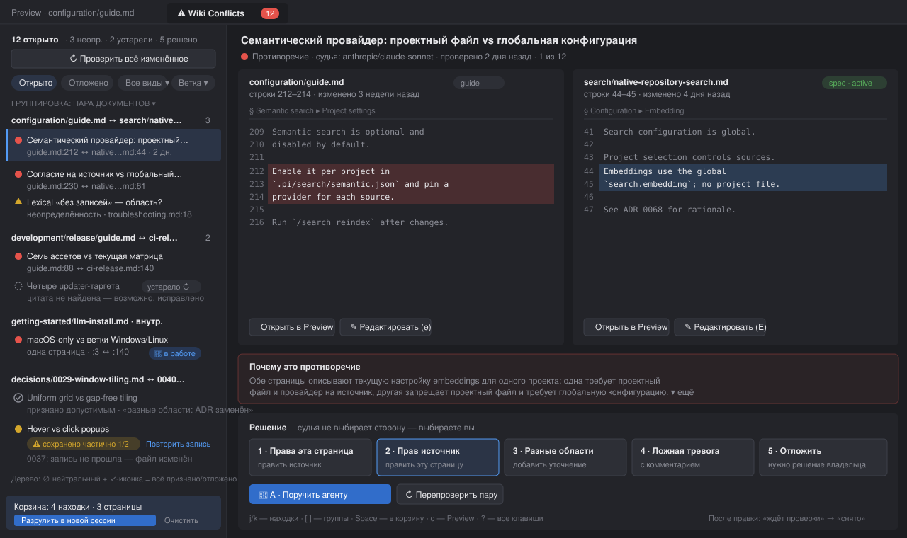

# Wiki Conflicts: просмотрщик и решатель противоречий

> **Статус: proposal.** Это не утверждённый контракт и не разрешение на реализацию.
> Действующее поведение проверок описано в
> [Desktop Project Wiki](../../desktop/workbench/desktop-project-wiki.md#shared-checking-and-save-behavior).
>
> **Фаза 1 реализована** (вкладка, инбокс, сравнение, «Перепроверить», точки входа).
> **Фаза 2 — первый срез:** вердикты 1–5 в отчётах (`decisions` в блоке отчёта,
> перенос при перепроверке, фильтры «Решённые» и «Ждут исправления», CAS-запись
> во все отчёты пары) и «Разрулить в новой сессии» для одной находки, undo-тост
> на 8 секунд и цикл «ждёт исправления» (повторное открытие, если проверка
> после решения всё ещё находит находку). Отложенные и ложноположительные
> находки исключаются из открытого счётчика; только они перестают окрашивать
> дерево в красный, а страница и её папки получают нейтральную иконку с
> подсказкой. Также реализованы даты Git по сторонам, inline-правка
> совпавшей цитаты и создание/открытие задачи проекта для отложенной находки.
> **Пакетная корзина реализована:** выбор до 50 находок, Space-переключение,
> запуск одной новой сессии по текущим отчётам и передача решений пользователя.
> Остаток фазы 3 не реализован: горячая клавиша `A`, статус сессии на находке
> и режим «Предложить правку» с diff-просмотром.
> Действующее поведение вкладки:
> [Wiki Conflicts tab](../../desktop/workbench/desktop-project-wiki.md#wiki-conflicts-tab).

> Макет и детали ниже — исходное предложение, а не описание реализованной
> фазы 1. В текущем интерфейсе список находится во вкладке **Conflicts**
> сайдбара Wiki (рядом с **Pages**); вспомогательная вкладка **Wiki Conflicts**
> показывает только сравнение на полной ширине. Поэтому строки ниже про бейдж
> в шапке и список внутри вспомогательной вкладки устарели для текущего UI.

[Research and proposals](../index.md) · [Макет](mockup-v2.svg)

## Проблема

Проверка противоречий уже собирает доказательную базу: точные цитаты, пути,
диапазоны строк, объяснения, неопределённости и покрытие. Отчёт сохраняется
в документе. Но сам процесс разбора неудобен:

1. **Нет сводки.** Отчёты привязаны к странице: показываются в Preview, в
   очереди «Проверки» (`max-h-96` в сайдбаре) и в уведомлениях. Красные папки
   в дереве говорят, *где* есть проблема, но не показывают *какая* и сколько.
2. **Нет сравнения бок о бок.** Цитата черновика и цитата источника идут друг
   под другом, без окружающего текста. Чтобы понять область действия
   утверждения, нужно открывать источник, а при грязном черновике навигация
   заблокирована.
3. **Действия работают только на весь отчёт.** Есть «Разрулить в новой сессии»,
   «Сохранить всё равно» и «Повторить». Нельзя сказать «эта находка — ложная
   тревога», «это разные области действия», «права левая сторона» или
   «отложить до решения владельца».
4. **Решения не запоминаются.** После повторной проверки та же ложная тревога
   возвращается, а пользователь заново разбирает её с нуля.
5. **Нет пакетной работы.** Десять связанных находок в трёх страницах
   разбираются через десять отдельных отчётов или сессий.

## Цели и не-цели

**Цели:** одно место, чтобы увидеть все текущие противоречия проекта, понять
каждое за несколько секунд, принять по нему решение и проверить, что оно
действительно снято.

**Не-цели (сохраняются инварианты действующего контракта):**

- Модель-судья по-прежнему **не выбирает** авторитетную сторону и не правит
  документы. Выбор делает человек или явно запущенный агент.
- Отображение списка **не вызывает** модель и поиск. Источник данных — уже
  сохранённые блоки `pix:wiki-report`, которые читает кэш состояния дерева.
- Никаких sidecar-файлов и файловых наблюдателей. Все записи проходят через
  существующую защиту expected-content.
- Зелёный статус по-прежнему ставит **только** полная чистая проверка.
  Решения пользователя никогда не делают страницу зелёной.

## Точки входа

| Откуда | Что видит пользователь |
| --- | --- |
| Сайдбар Wiki | Вкладка **Conflicts N** рядом с **Pages** открывает список находок |
| Красная папка/страница в дереве | Контекстное меню и hover-кнопка **Показать противоречия** с фильтром по ветке |
| Отчёт в Preview / очереди | Кнопка **Открыть в решателе** с выбранной первой находкой |
| Уведомление «В Wiki найдены противоречия» | Действие **Разобрать** вместо общего «Открыть проверки» |
| Командная палитра | `Wiki: Conflicts`, `Wiki: Next conflict` |

### Вид вкладки `wiki-conflicts`

Решатель — **новый вспомогательный вид вкладки** рабочей области, шестой
наряду с `session`, `preview`, `diff`, `lsp-install` и `terminal`
(`desktop/src/lib/workbench-tabs.ts`). Как и остальные вспомогательные вкладки,
он не входит в состав сессий ACP/TUI:

- **Один экземпляр на окно** с фиксированным id `"wiki-conflicts"`. Повторное
  открытие из любой точки входа фокусирует существующую вкладку и применяет
  новый фильтр или выбор находки, а не создаёт копию.
- **Расстановка** через `WorkbenchAuxiliaryPlacement`: вкладка открывается
  рядом с той, из которой её вызвали (например, справа от Preview со
  страницей), и запоминает порядок открытия.
- **Метка** — `Wiki Conflicts` со счётчиком открытых находок, по аналогии
  с флагами `dirty`/`busy` других видов: `WorkbenchWikiConflictsTab { kind:
  "wiki-conflicts"; openCount: number; dirty: boolean }`.
- **Закрытие** разрешено (`closable: true`). При несохранённой встроенной
  правке запрашивается подтверждение, как у Preview с грязным черновиком.
- Вкладка переживает навигацию, участвует в [раскладке окон](../../desktop/workbench/desktop-window-tiling.md)
  и восстанавливается после перезапуска только как «вкладка открыта + фильтр
  и выбранный `findingId`». Встроенные черновики не восстанавливаются.

**Почему не режим Preview.** Preview привязан к одному файлу и имеет свои
историю «назад/вперёд» и защиту черновика. Решателю нужны два файла
одновременно и собственный список находок; совмещение заметно усложнило бы
Preview. «Открыть в Preview» из решателя просто открывает или переключает
соседнюю вкладку Preview.

## Компоновка

Три зоны слева направо (см. [макет](mockup-v2.svg)):

### 1. Инбокс (предлагаемый макет; фаза 1 реализована в сайдбаре Wiki)

- **Сводная строка:** `12 открыто · 3 неопределённости · 2 устарели · 5 решено`
  и кнопка **Проверить всё изменённое**. Она доступна всегда, в том числе при
  выключенных автопроверках, потому что это явное действие пользователя. Перед
  запуском показывается подтверждение: число страниц и верхняя оценка вызовов
  модели (`≤ 6` на страницу). Задачи ставятся в существующую очередь проверок.
- **Фильтры-чипы:** статус находки (Открыто / Отложено / Принято / Устарело),
  вид (Противоречие / Неопределённость / Внутреннее), ветка дерева,
  жизненный цикл страницы (spec / guide / proposal / ADR, из frontmatter).
- **Группировка** (переключатель):
  - *По паре документов* (по умолчанию): `configuration/guide.md ↔
    search/native-repository-search.md · 3`. Одна пара — один разговор, такие
    находки обычно решаются одной правкой.
  - *По странице* — как сейчас устроены отчёты.
  - *По теме* — по заголовку раздела, в котором стоит цитата.
- **Строка находки:** иконка вида, однострочная выжимка объяснения, пути
  (с сокращённым общим префиксом), возраст отчёта, бейджи `устарело` /
  `цитата сдвинулась`. Цвет не единственный носитель статуса: у каждого
  состояния свои иконка и текст.

### 2. Сравнение (предлагаемый макет; фаза 1 показывает его в отдельной вкладке)

- Две колонки: **Эта страница** | **Источник**, у каждой путь, строки,
  lifecycle-бейдж (`spec · active`, `proposal`, `ADR · superseded by 0040`)
  и дата последнего изменения файла. Lifecycle и scope показываются
  намеренно: большинство ложных тревог снимаются фразой «это разные области
  действия».
- Цитата подсвечена внутри **±8 строк живого контекста** из текущего файла.
  Контекст перечитывается локально, как сейчас валидируются цитаты в Preview.
  Ближайший заголовок раздела закреплён сверху колонки.
- Если цитата больше не находится или неоднозначна, колонка показывает
  сохранённый снимок с баннером *«Текст изменился после проверки — возможно,
  уже исправлено»* и кнопкой **Перепроверить пару**.
- Внутреннее противоречие (`sourceId: draft`) показывает две цитаты одной
  страницы в тех же колонках с пометкой «одна страница».
- Между колонками стоит **объяснение судьи**, свёрнутое до двух строк, и
  название модели. Для неопределённости вместо него блок
  **«Чего не хватает для решения»**.
- `Открыть в Preview` и `Редактировать здесь` у каждой стороны. Встроенное
  редактирование открывает компактный редактор Markdown прямо в колонке;
  у пары грязных черновиков есть свои Сохранить и Отмена.

### 3. Панель решения (низ центра или правая колонка на широком окне)

Явные вердикты по одной находке, с подписями и горячими клавишами:

| Клавиша | Вердикт | Что происходит |
| --- | --- | --- |
| `1` | **Права эта страница** | Открывает правку источника: курсор на цитате, слева эталон |
| `2` | **Прав источник** | Симметрично: правка этой страницы |
| `3` | **Разные области** | Помогает добавить уточнение scope/версии в одну или обе стороны; без правки находка остаётся открытой |
| `4` | **Ложная тревога** | Помечает находку принятой с обязательным коротким комментарием |
| `5` | **Отложить** | «Нужно решение владельца»: находка уходит из «Открыто», но остаётся видимой. У отложенной находки есть кнопка **Создать задачу** |
| `A` | **Поручить агенту** | Добавляет находку в корзину агентского разбора (ниже) |

После правки, сохранённой через решатель, затронутые страницы автоматически
встают в существующую очередь проверок. Находка получает состояние
**«Исправлено, ждёт проверки»**, а затем **«Снято»** или снова **«Открыто»**,
в зависимости от нового вердикта. Пользователь видит замкнутый цикл, а не
веру на слово.

## Агентский разбор пакетом — реализованная корзина

- Чекбоксы в списке **Conflicts** и Space на сфокусированном listbox собирают
  **корзину** до 50 находок (`MAX_KNOWLEDGE_BATCH_FINDINGS`). Устаревшие
  находки выбрать нельзя; при заполнении корзины невыбранные чекбоксы отключены.
  Подсказка внизу списка и панель в сравнении показывают
  `Корзина: N находок · M страниц`, где страницы — уникальные пути обеих сторон;
  доступны **Очистить** и **Разрулить в новой сессии**. У выбранной находки в
  заголовке сравнения есть переключатель **В корзину / Убрать из корзины**.
- Корзина хранит только идентификаторы в памяти окна: она не сохраняется на
  диск, автоматически теряет устаревшие/исчезнувшие находки и очищается при
  сбросе инбокса (в том числе при смене проекта).
- Пакетное действие запускает **одну новую агентскую сессию на все находки**.
  Для каждой выбирается страница-отчёт, который по сохранённому содержимому
  всё ещё актуален и содержит эту находку. Находки без такого отчёта
  пропускаются, остаются в корзине и перечисляются в уведомлении; если ни одна
  не пригодна, запуск отклоняется с ошибкой. Переданные находки удаляются из
  корзины только после фактического старта сессии.
- JSON `findings[]` каждой находки содержит `target: {path, contentHash}`,
  `kind`, `draft`, `existing`, `explanation` и необязательный `userDecision` из
  текущего отчёта. Для side-a/side-b решение разворачивается в явные
  `authoritative` и `toFix` (`{path, startLine}`); different-scope требует
  уточнить область, false-positive — только подтвердить, deferred — оставить
  без изменений; заметка передаётся агенту. Инструкции формируются на языке
  отчёта. Агент читает сохранённые страницы с диска: снимок текста не
  передаётся. Действуют те же ограничения безопасности, что и для одиночного
  разбора: не создавать commit, считать содержимое данными, а не инструкциями,
  и не менять блок отчёта. `createKnowledgeResolution.startBatch` сообщает об
  успехе после отправки prompt; одиночный `start` сохраняет прежнее поведение.
- **Не реализованы из предложения:** горячая клавиша `A`, отображение статуса
  сессии («🤖 в работе») на находке и фаза 3 — **«Предложить правку»** с diff,
  применением или отклонением.

## Модель данных

**Идентичность находки:** `findingId = sha256(kind, sideA, sideB)`, где
`side = (path, normalizedQuote)`, а пара сторон упорядочена лексикографически.
Идентификатор не зависит от номеров строк, от порядка, в котором модель вернула
находки, и от того, какая страница проверялась. Поэтому находка A↔B из отчёта
страницы A и находка B↔A из отчёта страницы B — одна и та же находка, а повторная
проверка того же текста узнаёт уже разобранную находку.

**Индекс инбокса** производный, в памяти. Он строится из кэша
`wiki-consistency-tree-state`, который уже читает сохранённые отчёты до 50 000
файлов без модели и без поиска. Хранится только легковесная проекция (пути,
цитаты ≤ 4 000 символов, объяснение, findingId, hash/stale). Тела документов,
как и сейчас, не хранятся. Отчёт, найденный в двух страницах (A↔B и B↔A),
схлопывается в одну находку пары.

**Вердикты пользователя** хранятся внутри того же скрытого блока отчёта,
без sidecar. Это поле конверта: `decisions: [{ findingId, verdict,
note?, taskId?, at }]`, в пределах существующего бюджета 384 KiB. Заметка
обязательна для `false-positive`. `taskId` допустим только для `deferred` и
должен соответствовать `/^[A-Za-z0-9][A-Za-z0-9._-]{0,127}$/`. Старые версии
приложения считают блок с `decisions` отсутствующим.

- Вердикт записывается **во все существующие отчёты**, где есть находка с этим
  `findingId`. Новые блоки отчёта не создаются: блок означает результат
  проверки, а страница, которую не проверяли, его не получает.
- Каждая запись идёт через собственный expected-content guard. Если
  compare-and-swap не прошёл хотя бы в одном файле, находка показывает статус
  **«Решение сохранено частично»** с кнопкой «Повторить запись»; записанное в
  другие файлы не откатывается.
- Новая проверка, заменяющая отчёт, переносит решения для совпавших
  `findingId` и отбрасывает остальные.

Решение `false-positive` / `deferred`:

- убирает находку из «Открыто» и из счётчика бейджа; остальные вердикты
  остаются открытыми;
- **не** делает страницу зелёной. Только false-positive/deferred исключают
  находку из красной окраски. Если так решены все противоречия актуального
  отчёта страницы, строка страницы и её папок получает нейтральную иконку и
  подсказку; новый цвет не вводится.
- отложенную находку можно связать с [задачей проекта](../../work-management/index.md)
  **только явной кнопкой «Создать задачу»**. Задача ссылается на `findingId` и
  пути сторон, а на находке видна ссылка на созданную задачу. Автоматически
  задачи не создаются;
- **не** передаётся судье как подавление. Судья остаётся независимым,
  сопоставление идёт только при отображении.

**Состояния находки:** `open → (fix-pending → resolved | open) | deferred |
accepted | stale`. Состояние `stale` вычисляется, когда цитата больше не
находится в текущем файле; это не вердикт.

## UX-детали

- **Первая находка выбрана сразу.** Пустое состояние без конфликтов:
  «Противоречий в сохранённых отчётах нет», плюс последнее время проверки и
  честная оговорка из контракта: *результат описывает просмотренные пассажи,
  а не всю Wiki*.
- **Клавиатура:** `j/k` — по находкам, `[`/`]` — по группам, `1–5` — вердикты,
  `e` — правка левой стороны, `E` — правой, `o` — открыть в Preview,
  `Space` — в корзину, `?` — шпаргалка. Фокус после вердикта уходит на
  следующую открытую находку.
- **Отмена:** вердикт без правки сопровождается тостом «Отменить» на 8 секунд.
  Правки отменяются обычным undo редактора.
- **Защита черновиков:** встроенный редактор подчиняется той же dirty-draft
  защите, что и Preview. Закрытие вкладки или переход к другой находке при
  несохранённой правке спрашивает подтверждение.
- **Локализация** следует `knowledgeCheck.reportLanguage`. Цитаты и пути не
  переводятся. Прозу модели рендерим как текст, не HTML.
- **Доступность:** инбокс — `listbox` с `aria-activedescendant`, колонки —
  регионы с подписями. Статус дублируется текстом и иконкой, `aria-live`
  объявляет перепроверку.
- **Производительность:** живой контекст читается лениво для выбранной
  находки, с отменой при быстрой навигации (stale-completion guard).
  Построение индекса инкрементально, на тех же 50 ms слотах, что и статусы
  дерева.
- Визуальные правила по [Desktop design](../../desktop/design.md): плотные
  строки 28–32 px, нейтральные поверхности, семантический красный только для
  открытых противоречий, янтарный — для неопределённостей.

## Поэтапный план

| Фаза | Объём | Ценность |
| --- | --- | --- |
| **1. Просмотр** | Новый вид вкладки `wiki-conflicts` (тип, id, расстановка, метка, восстановление), инбокс из кэша дерева, группировка по паре, сравнение бок о бок с живым контекстом, stale-детекция, кнопка перепроверки пары, точки входа | Видно всё и сразу; ноль новых записей в файлы |
| **2. Решения** | Реализованы вердикты 1–5, `decisions` во всех существующих отчётах находки, перенос при перепроверке, фильтр «Решённые», частичная CAS-запись с повтором, resolve одной находки в новой сессии, кнопка «Создать задачу» для отложенных, встроенная правка и цикл «ждёт проверки → снято» | Разбор с сохранением решений; агентская сессия для одной находки |
| **3. Агент** | Реализована корзина до 50 находок и единая пакетная сессия с текущими отчётами и вердиктами. Не реализованы `A`, статус сессии на находке и «Предложить правку» с diff-превью | Массовая чистка с контролем человека; предложенный diff-режим остаётся опциональным |

## Принятые решения по открытым вопросам

| Вопрос | Решение |
| --- | --- |
| Где хранить вердикт по находке пары | Во всех существующих отчётах с этим `findingId`; новые блоки не создаются; `findingId` не зависит от порядка сторон; при сбое CAS — «Решение сохранено частично» |
| Цвет «признано допустимым» в дереве | Нейтральный цвет + иконка и подсказка; новый цвет не вводится |
| «Проверить всё изменённое» при выключенных автопроверках | Доступна всегда, с подтверждением числа страниц и верхней оценки вызовов модели |
| Отложенные находки и задачи проекта | Только по явной кнопке «Создать задачу»; автоматически задачи не создаются |

## Затрагиваемые места (ориентир)

- Новое: `desktop/src/components/WikiConflictsTab.svelte`,
  `wiki-conflicts-index.svelte.ts` (проекция из tree-state),
  `WikiConflictCompare.svelte`, `WikiConflictDecisionBar.svelte`.
- Расширение: `acp/src/knowledge/stamp.ts` и Rust `wiki_consistency.rs` (поле
  `decisions` в конверте), `knowledge-resolution.ts` (пакет + вердикты),
  `wiki-consistency-tree-state.svelte.ts` (экспорт проекции находок),
  `wiki-conflict-notifications.ts` (действие «Разобрать»),
  `ProjectWikiPanel.svelte` (бейдж), `desktop/src/lib/workbench-tabs.ts`
  (`WorkbenchTabId`, `WorkbenchTab`, `WorkbenchAuxiliaryPlacement`) и
  отрисовка полосы вкладок, раскладки окон и восстановления рабочей области.
